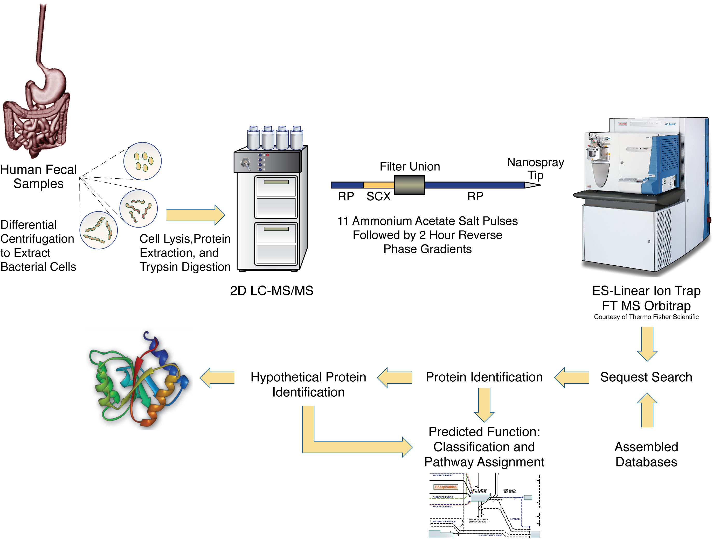
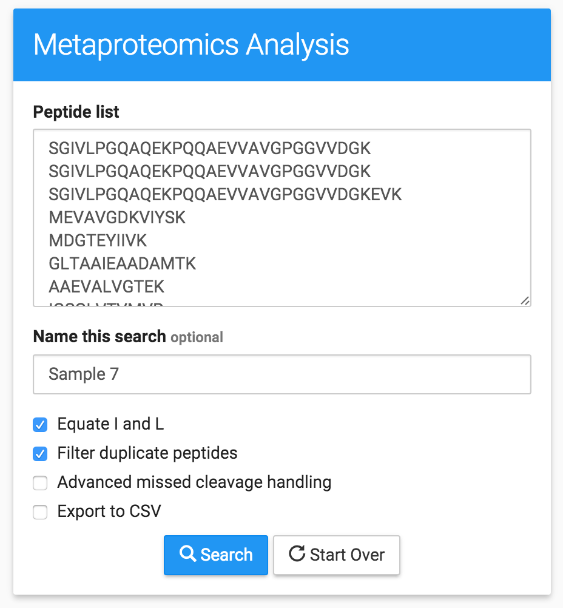
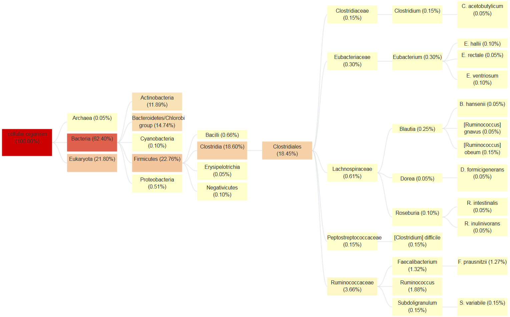

## Introduction

Over the period of evolution, we human beings have co-evolved an intricate symbiosis with microorganisms that inhabit
our gastrointestinal tract. These microorganisms are responsible for maintaining a healthy gut environment, they aid in
digestion of our food and our immune system and they guard us against invading pathogens. In addition, some diseases,
such as [Crohn's disease](https://en.wikipedia.org/wiki/Crohn%27s_disease), are somehow correlated to the composition of
the gut microbiota. Although we are dependent on microorganisms for normal gut functioning, much remains to be learned
about microbial processes in the gut that are carried out by this huge community of largely unexplored microbial cells
that can amount to numbers as great as 10<sup>11</sup> per gram of faeces.

Recently, we have been aided by the development of molecular tools that enable us to determine the composition of
microorganisms inhabiting the intestine without having to cultivate them. In addition to the increasing amounts of
information about the identities of microorganisms in the gut from our own studies and others, there have been a limited
number of studies of the functional genes in the entire gut microbial metagenome, using sequencing based metagenomics
approaches.

A next step is to determine what genes are actually expressed and the function of the gut microbiota in different states
of health and disease. *Shotgun proteomics* ([Figure 1](#fig1)) is one approach that can be used to determine what
proteins were expressed in an environmental sample. As of today, this technique is still in its infancy, but given the
rapid technological developments and based on the results of the first analyses, we can nevertheless consider this to be
a very promising technique.



**Figure 1** Shotgun metaproteomics approach used to identify microbial proteins in human faecal samples. Taken from Verberkmoes et al. (2009). {#fig1}

## Getting started

Before the Unipept command line interface (CLI) can be used, it first needs to be [installed locally](../index.md).
Since the Unipept CLI is distributed as an npm package, [Node.js](https://nodejs.org/en/download/package-manager) must
be installed first (at least version 22). The Unipept CLI can then be installed using the `npm` command, which is the
package manager that ships with Node.js.

```console
$ npm install -g unipept-cli
added 3 packages in 986ms
```

The `-g` flag installs the Unipept CLI for all users on the computer system. If you do not have the necessary
permissions for a system wide installation, npm can be pointed at a directory you own instead, as described on the [npm
website](https://docs.npmjs.com/resolving-eacces-permissions-errors-when-installing-packages-globally).

The Unipept CLI is a bundle of different commands that all come with detailed [online documentation](../index.md).
Naturally, the most important command is `unipept`.

```console
$ unipept --help
Usage: unipept [options] [command]

The unipept subcommands are command line wrappers around the Unipept web
services.

Subcommands that start with pept expect a list of tryptic peptides as input.
Subcommands that start with tax expect a list of NCBI Taxonomy Identifiers as
input. Input is passed

- as separate command line arguments
- in a text file that is passed as an argument to the -i option
- to standard input

The command will give priority to the first way the input is passed, in the
order as listed above. Text files and standard input should have one tryptic
peptide or one NCBI Taxonomy Identifier per line.

Options:
  -V, --version                          output the version number
  -h, --help                             display help for command

Commands:
  pept2ec [options] [peptides...]        Fetch EC numbers of UniProt entries that match tryptic peptides.
  pept2funct [options] [peptides...]     Fetch EC numbers, GO terms and InterPro codes of UniProt entries that match tryptic peptides.
  pept2go [options] [peptides...]        Fetch GO terms of UniProt entries that match tryptic peptides.
  pept2interpro [options] [peptides...]  Fetch InterPro entries of UniProt entries that match tryptic peptides.
  pept2lca [options] [peptides...]       Fetch taxonomic lowest common ancestor of UniProt entries that match tryptic peptides.
  pept2prot [options] [peptides...]      Fetch UniProt entries that match tryptic peptides.
  pept2taxa [options] [peptides...]      Fetch taxa of UniProt entries that match tryptic peptides.
  peptinfo [options] [peptides...]       Fetch functional information and the taxonomic lowest common ancestor of UniProt entries that match tryptic peptides.
  protinfo [options] [proteins...]       Fetch functional and taxonomic information of UniProt ids
  taxa2lca [options] [taxonids...]       Compute taxonomic lowest common ancestor for given list of taxa.
  taxonomy [options] [peptides...]       Fetch taxonomic information from Unipept Taxonomy.
  help [command]                         display help for command
```

As the `unipept` command makes calls to the Unipept API that is provided by an instance of the Unipept application
server (web services that communicate with an instance of the Unipept database), the location of the Unipept application
server must be [configured](../index.md). By default, the public Unipept server (api.unipept.ugent.be) is used, but this
can be changed by passing the URL of the server as an argument to the option `--host`. The `--host` option belongs to
the subcommand rather than to `unipept` itself, so it goes after the subcommand name.

```console
$ unipept pept2lca --host 'https://api.unipept.ugent.be' ENFVYIAK
peptide,cutoff_used,taxon_id,taxon_name,taxon_rank
ENFVYIAK,,1,root,no rank
```

## Taxonomic analysis

As a demonstration of the Unipept CLI we show how it can be used to get insight into the biodiversity within one of the
faecal samples from a gut microbiome study (Verberkmoes et al. (2009)). The sample was taken from a female that
is part of a healthy monozygotic twin pair born in 1951 that was invited to take part in a larger double-blinded study.
Details of this individual with respect to diet, antibiotic usage, and so on are described by Dicksved et al. (2008) (individual 6a in this study, sample 7 in the study of Verberkmoes et al. (2009)).
The most important that we learn from the available information in the questionnaire that this individual has filled up,
is that she had gastroenteritis at the time the sample was taken and that her twin sister (individual 6b in the study of
Dicksved et al. (2008), sample 7 in the study of Verberkmoes et al. (2009)) had taken non-steroidal
anti-inflammatory drugs during the past 12 months before the time of sampling. The data can be downloaded from the
[website of the study](https://www.nature.com/articles/ismej2008108#bib7) and is also available as a demo data set on
the Unipept website.

Say that we stored the list of tryptic peptides that were extracted from sample 7 in the study of Verberkmoes et al. (2009) in the text file [sample7.dat](/sample7.dat). The file contains a list of all tryptic
peptides, each on a separate line. The following session shows that this file contains a list of 3983 tryptic peptides
(2065 unique peptides) that could be identified in the faecal sample using *shotgun metaproteomics*.

```console
$ head sample7.dat
SGIVLPGQAQEKPQQAEVVAVGPGGVVDGK
SGIVLPGQAQEKPQQAEVVAVGPGGVVDGK
SGIVLPGQAQEKPQQAEVVAVGPGGVVDGKEVK
MEVAVGDKVIYSK
MDGTEYIIVK
GLTAAIEAADAMTK
AAEVALVGTEK
IGSGLVTVMVR
IGSGLVTVMVR
AAVESGSAAASR
$ wc -l sample7.dat
3983 sample7.dat
$ sort -u sample7.dat | wc -l
2065
```

The first thing that strikes the eye is that a mass spectrometer might pick up multiple copies of the same tryptic
peptide from an environmental sample. Depending on the fact whether or not we can draw quantitative conclusion on the
number of different identifications of a particular peptide (apart from identification, the quantification of proteins
in an environmental sample is an important research theme (Seifert et al. (2013); Kolmeder & de Vos (2014))), we might decide to deduplicate the peptides before they are analysed further using the Unipept CLI. This decision
has an impact on the analysis results, but deduplication also results in improved performance since it avoids duplicate
work.

What might be less obvious at first sight, is that the peptides on lines 3 and 4 in the text file
[sample7.dat](/sample7.dat) actually aren't tryptic peptides, but the composition of two tryptic peptides. This is a
consequence of the fact that cleavage of proteins using trypsin is not always perfect, leading to some proteins that
aren't cleaved properly. Such composed tryptic peptides are called *missed cleavages*. The index structure underpinning
Unipept only indexes tryptic peptides that result from an *in silico* trypsin digest of the proteins in UniProt, so that
missed cleavages cannot be matched directly by Unipept.

To cope with this problem, we can start to check if the peptides resulting from a *shotgun metaproteomics* experiment
need to be cleaved further before making taxonomic identifications using Unipept. Performing an *in silico* trypsin
digest can be done using the `prot2pept` command from the Unipept CLI. This command is executed purely *client side*,
and thus is provided as a standalone command and not as a subcommand of the `unipept` command.

```console
$ sed -ne '4{p;q}' sample7.dat
MEVAVGDKVIYSK
$ sed -ne '4{p;q}' sample7.dat | prot2pept
MEVAVGDK
VIYSK
```

Once a peptide is broken into multiple tryptic peptides, the lowest common ancestor can be computed for each tryptic
peptide using the `unipept pept2lca` command. Next to accepting tryptic peptides as arguments, the command can also read
one ore more tryptic peptides from standard input if no arguments were passed. Each tryptic peptide should be on a
separate line when using standard input.

```console
$ unipept pept2lca -e SGIVLPGQAQEKPQQAEVVAVGPGGVVDGK MDGTEYIIVK
peptide,taxon_id,taxon_name,taxon_rank
SGIVLPGQAQEKPQQAEVVAVGPGGVVDGK,1263,Ruminococcus,genus
MDGTEYIIVK,1263,Ruminococcus,genus
$ sed -ne '3{p;q}' sample7.dat
SGIVLPGQAQEKPQQAEVVAVGPGGVVDGKEVK
$ sed -ne '3{p;q}' sample7.dat | unipept pept2lca -e
$ sed -ne '3{p;q}' sample7.dat | prot2pept
SGIVLPGQAQEKPQQAEVVAVGPGGVVDGK
EVK
$ sed -ne '3{p;q}' sample7.dat | prot2pept | unipept pept2lca -e
peptide,taxon_id,taxon_name,taxon_rank
SGIVLPGQAQEKPQQAEVVAVGPGGVVDGK,1263,Ruminococcus,genus
```

Unipept only indexes tryptic peptides extracted from UniProt sequences that have a length between 5 and 50 amino acids
(boundaries included). This choice was driven by the detection limits of most common mass spectrometers. As a result, an
additional time saver is to search for tryptic peptides that have less than 5 of more than 50 amino acids, because
Unipept will never find protein matches for these peptides. The `peptfilter` command from the Unipept CLI can be used to
filter out peptides that are too short or too long prior to the taxonomic identification step. By default, it filters
out all peptides for which it is known in advance that Unipept will find no matches.

```console
$ sed -ne '3{p;q}' sample7.dat | prot2pept | peptfilter | unipept pept2lca -e
peptide,taxon_id,taxon_name,taxon_rank
SGIVLPGQAQEKPQQAEVVAVGPGGVVDGK,1263,Ruminococcus,genus
```

All commands of the Unipept CLI follow the input/output paradigm of the Unix command line, so that they be chained
together seamlessly. This way, for example, we can determine the LCAs for the first six peptides of sample 7 by
combining the previous processing steps: split missed cleavages, filter out peptides that are too short or too long,
equate leucine (residue CodeL) and isoleucine (residue `I`), and deduplicate the tryptic peptides.

```console
$ head -n6 sample7.dat | prot2pept | peptfilter | tr I L | sort -u
GLTAALEAADAMTK
MDGTEYLLVK
MEVAVGDK
SGLVLPGQAQEKPQQAEVVAVGPGGVVDGK
VLYSK
$ head -n6 sample7.dat | prot2pept | peptfilter | tr I L | sort -u | unipept pept2lca -e
peptide,taxon_id,taxon_name,taxon_rank
GLTAALEAADAMTK,186802,Clostridiales,order
MDGTEYLLVK,1263,Ruminococcus,genus
MEVAVGDK,1263,Ruminococcus,genus
SGLVLPGQAQEKPQQAEVVAVGPGGVVDGK,1263,Ruminococcus,genus
VLYSK,1,root,no rank
```

## Comparison with the Unipept web interface

The biodiversity in sample 7 from the study of Verberkmoes et al. (2009) can be easily computed and visualised
using the *Metagenomics Analysis* feature of the [Unipept website](/). All it takes is to paste the list of peptides
that were identified from an environmental sample in a text area, select the appropriate search options, and to click
the Search button to launch the identification process.

In the session that is shown in [Figure 2](#fig2), we have indicated that no distinction should be made between leucine
(`L`) and isoleucine (`I`), that the peptides must be deduplicate prior to the actual biodiversity analysis, and that
the results must be exported in csv format (*comma separated values*). Breaking up the missed cleavages happens by
default. In addition, the option *Advanced missed cleavage handling* can be activated to indicate that the results
should be aggregated as a post-processing step (not selected in this example).



**Figure 2** Processing of sample 7 from the study of Verberkmoes et al. (2009) using the Metaproteomics
Analysis feature of the [Unipept website](/). In this example session we indicate that no distinction should be made
between leucine (`L`) and isoleucine (`I`), that the peptides must be deduplicated, and that the results must be
exported in csv format (*comma separated values*). Breaking up the missed cleavages happens by default. In addition, the
option *Advanced missed cleavage handling* can be activated to indicate that the results should be aggregated as a
post-processing step (not selected in this example). {#fig2}

The same result can be obtained using the following combination of commands from the Unipept CLI. The timing gives an
impression of the performance of Unipept to compute the LCAs for all 2005 unique tryptic peptides extracted from sample
7. It indicates that part of the processing is parallelised, and that the majority of the processing time is consumed by
exchanging data between the client and the Unipept server and the server-side processing of the data.

```console
$ prot2pept < sample7.dat | peptfilter | tr I L | sort -u | wc -l
2005
$ time prot2pept < sample7.dat | peptfilter | tr I L | sort -u | unipept pept2lca -e > sample7.csv

real    0m0.329s
user    0m0.465s
sys     0m0.038s
$ head sample7.csv
peptide,taxon_id,taxon_name,taxon_rank
AAALNLVPNSTGAAK,2,Bacteria,domain
AAALNTLAHSTGAAK,1678,Bifidobacterium,genus
AAALNTLPHSTGAAK,1678,Bifidobacterium,genus
AAAMSMLPTSTGAAK,2,Bacteria,domain
AAANESFGYNEDELVSSDLVGMR,186802,Clostridiales,order
AAANYLDLPLYR,2,Bacteria,domain
AAAVNLVPNSTGAAK,2,Bacteria,domain
AADAAAALGEGLQAFCLPGSVADHR,186802,Clostridiales,order
AADAAAALGEGLQAFCLPGSVADTR,186802,Clostridiales,order
```

For those that are not familiar with *IO redirection*, the `unipept` command also supports the `-i/--input` option to
read the peptides from the file that is passed as an argument and the `-o/--output` option to store the results in a
file that is passed as an argument.

```console
$ unipept pept2lca --input sample7.dat --output sample7.csv
$ head sample7.csv
peptide,taxon_id,taxon_name,taxon_rank
AAALNLVPNSTGAAK,2,Bacteria,domain
AAALNTLAHSTGAAK,1678,Bifidobacterium,genus
AAALNTLPHSTGAAK,1678,Bifidobacterium,genus
AAAMSMLPTSTGAAK,2,Bacteria,domain
AAANESFGYNEDELVSSDLVGMR,186802,Clostridiales,order
AAANYLDLPLYR,2,Bacteria,domain
AAAVNLVPNSTGAAK,2,Bacteria,domain
AADAAAALGEGLQAFCLPGSVADHR,186802,Clostridiales,order
AADAAAALGEGLQAFCLPGSVADTR,186802,Clostridiales,order
```

If needed, the `unipept pept2lca` command can be used in combination with the `-a` option to fetch the complete lineages
for all LCAs according to the Unipept Taxonomy. [Figure 3](#fig3) shows the hierarchical classification of the taxa that
could be identified in sample 7, with the node representing the order *Clostridiales* having the focus. A similar tree
view can be found in the *Treeview* tab on the page showing the results of a Metaproteomics analysis in the Unipept web
interface.



**Figure 3** Snapshot of an interactive tree view that shows the results of the biodiversity analysis of sample 7, a
metaproteomics data set from the study of Verberkmoes et al. (2009). The node that represents the order
*Clostridiales* has the focus. Percentages on the nodes indicate the relative amount of tryptic peptides that are
specific for the corresponding taxa or one of its subtaxa, and also correspond to the linear color gradient that was
used to color the nodes: red (100%) - light yellow (0%). {#fig3}

### References

- Dicksved, J., Halfvarson, J., Rosenquist, M., Järnerot, G., Tysk, C., Apajalahti, J., ... & Jansson, J. K. (2008).
  Molecular analysis of the gut microbiota of identical twins with Crohn's disease. The ISME journal, 2(7), 716-727.
- Kolmeder, C. A., & de Vos, W. M. (2014). Metaproteomics of our microbiome — developing insight in function and
  activity in man and model systems. Journal of proteomics, 97, 3-16.
- Seifert, J., Herbst, F. A., Halkjær Nielsen, P., Planes, F. J., Jehmlich, N., Ferrer, M., & Bergen, M. (2013).
  Bioinformatic progress and applications in metaproteogenomics for bridging the gap between genomic sequences and
  metabolic functions in microbial communities. Proteomics, 13(18-19), 2786-2804.
- Verberkmoes, N. C., Russell, A. L., Shah, M., Godzik, A., Rosenquist, M., Halfvarson, J., ... & Jansson, J. K. (2009).
  Shotgun metaproteomics of the human distal gut microbiota. The ISME journal, 3(2), 179-189.

