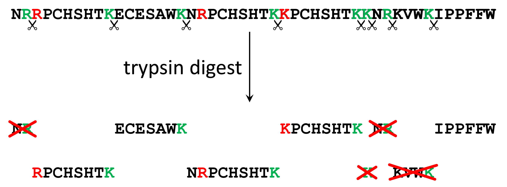
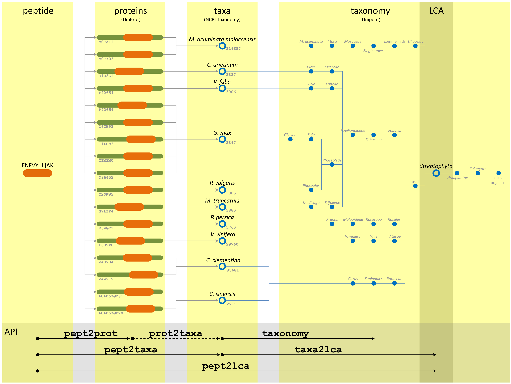
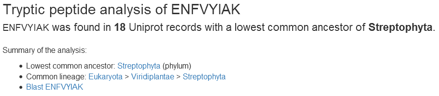

## Introduction

Because most proteins are simply too large to be analysed using a mass spectrometer, they are usually cleaved into
smaller peptides before the actual MS analysis takes place. In practice, most proteomics studies achieve such a cleavage
by adding trypsin to a protein sample. Trypsin is a serine protease found in the digestive system of humans and many
other vertebrates, where it helps to digest food proteins. The enzyme has a very specific function — it only cleaves
[peptide](https://en.wikipedia.org/wiki/Peptide) chains at the [carboxyl](https://en.wikipedia.org/wiki/Carboxylic_acid)
side of the [amino acids](https://en.wikipedia.org/wiki/Amino_acid) [lysine](https://en.wikipedia.org/wiki/Lysine)
(represented by the letter `K`) or [arginine](https://en.wikipedia.org/wiki/Arginine) (represented by the letter `R`).
As a result, it is commonly used in biological research during [proteomics](https://en.wikipedia.org/wiki/Proteomics)
experiments to digest proteins into peptides for mass spectrometry analysis, e.g., [in-gel
digestion](https://en.wikipedia.org/wiki/In-gel_digestion).

*High-performance liquid chromatography* (HPLC) is a [chromatographic](https://en.wikipedia.org/wiki/Chromatography)
technique used to separate the components in a mixture, to identify each component, and to quantify each component. When
combined with shotgun tandem mass spectrometric methods, the active proteins within a biological sample may be
determined. A trypsin digest is used to cleave the proteins in a sample downstream to every `K` (lysine) or `R`
(arginine), except when followed by `P` (proline). The individual components that result after the cleavage step are
called tryptic peptides. The amino acid sequence of these tryptic peptides may then be determined by means of mass
spectrometry. However, most devices have a detection limit that only allows to determine the amino acid sequence of
peptides having a length between 5 and 50 amino acids ([Figure 1](#fig1)).



**Figure 1** Tryptic digestion is a necessary step in protein absorption as proteins are generally too large to be
absorbed through the lining of the small intestine. Trypsin predominantly cleaves proteins at the carboxyl side (or
"C-terminal side") of the amino acids lysine (`K`) and arginine (`R`) except when either is bound to a C-terminal
proline (`P`). {#fig1}

By searching for all proteins that contain a particular tryptic peptide that was sequenced from an environmental sample,
we can get insight into the biodiversity and functionality of the biological sample. The [Unipept web application](/)
supports biodiversity analysis of large and complex metaproteome samples using tryptic peptide information obtained from
shotgun MS/MS experiments. Its underlying index structure is designed to quickly retrieve all occurrences of a tryptic
peptide in UniProt entries.



**Figure 2** General outline of the Unipept workflow for taxonomic identification of tryptic peptides. For a given
tryptic peptide, all UniProt entries having an exact match of the peptide in the protein sequence are found. Unipept
then computes the lowest common ancestor (LCA) of the taxonomic annotations extracted from the matched UniProt entries,
based on a cleaned up version of the NCBI Taxonomy. All intermediate results are shown for the sample tryptic peptide
`ENFVY[IL]AK` (isoleucine and leucine equated), leading to an LCA in the phylum Streptophyta. Arrows at the bottom show
which processing steps are available as functions in the [Unipept API](../../apidocs/index.md) and the [Unipept
CLI](../index.md). {#fig2}

## Getting started

Before the Unipept command line interface (CLI) can be used, it first needs to be [installed locally](../index.md).
Since the Unipept CLI is distributed as an npm package, [Node.js](https://nodejs.org/en/download/package-manager) must
be installed first (at least version 22). The Unipept CLI can then be installed using the `npm` command, which is the
package manager that ships with Node.js.

```console
$ npm install -g unipept-cli
added 3 packages in 986ms
```

The `-g` flag installs the Unipept CLI for all users on the computer system. If you do not have the necessary
permissions for a system wide installation, npm can be pointed at a directory you own instead, as described on the [npm
website](https://docs.npmjs.com/resolving-eacces-permissions-errors-when-installing-packages-globally).

The Unipept CLI is a bundle of different commands that all come with detailed [online documentation](../index.md).
Naturally, the most important command is `unipept`.

```console
$ unipept --help
Usage: unipept [options] [command]

The unipept subcommands are command line wrappers around the Unipept web
services.

Subcommands that start with pept expect a list of tryptic peptides as input.
Subcommands that start with tax expect a list of NCBI Taxonomy Identifiers as
input. Input is passed

- as separate command line arguments
- in a text file that is passed as an argument to the -i option
- to standard input

The command will give priority to the first way the input is passed, in the
order as listed above. Text files and standard input should have one tryptic
peptide or one NCBI Taxonomy Identifier per line.

Options:
  -V, --version                          output the version number
  -h, --help                             display help for command

Commands:
  pept2ec [options] [peptides...]        Fetch EC numbers of UniProt entries that match tryptic peptides.
  pept2funct [options] [peptides...]     Fetch EC numbers, GO terms and InterPro codes of UniProt entries that match tryptic peptides.
  pept2go [options] [peptides...]        Fetch GO terms of UniProt entries that match tryptic peptides.
  pept2interpro [options] [peptides...]  Fetch InterPro entries of UniProt entries that match tryptic peptides.
  pept2lca [options] [peptides...]       Fetch taxonomic lowest common ancestor of UniProt entries that match tryptic peptides.
  pept2prot [options] [peptides...]      Fetch UniProt entries that match tryptic peptides.
  pept2taxa [options] [peptides...]      Fetch taxa of UniProt entries that match tryptic peptides.
  peptinfo [options] [peptides...]       Fetch functional information and the taxonomic lowest common ancestor of UniProt entries that match tryptic peptides.
  protinfo [options] [proteins...]       Fetch functional and taxonomic information of UniProt ids
  taxa2lca [options] [taxonids...]       Compute taxonomic lowest common ancestor for given list of taxa.
  taxonomy [options] [peptides...]       Fetch taxonomic information from Unipept Taxonomy.
  help [command]                         display help for command
```

As the `unipept` command makes calls to the Unipept API that is provided by an instance of the Unipept application
server (web services that communicate with an instance of the Unipept database), the location of the Unipept application
server must be [configured](../index.md). By default, the public Unipept server (api.unipept.ugent.be) is used, but this
can be changed by passing the URL of the server as an argument to the option `--host`. The `--host` option belongs to
the subcommand rather than to `unipept` itself, so it goes after the subcommand name.

```console
$ unipept pept2lca --host 'https://api.unipept.ugent.be' ENFVYIAK
peptide,cutoff_used,taxon_id,taxon_name,taxon_rank
ENFVYIAK,,1,root,no rank
```

## The Unipept commands

Using the `unipept` command with a single tryptic peptide passed as an argument or read from *standard input*,
corresponds to using the [Tryptic Peptide Analysis](/tpa) feature from the Unipept web interface ([Figure 3](#fig3)).
Activating the option Equate I and L in the web interface corresponds to using the `-e` option with the `unipept`
command.


**Figure 3** Taxonomic identification of the tryptic peptide `ENFVYIAK` using the [Tryptic Peptide Analysis](/tpa)
feature from the Unipept web interface. {#fig3}

The `unipept pept2prot` command is an implementation of the `pept2prot` step in [Figure 2](#fig2). This command can
therefore be used to fetch all UniProt proteins that contain (exact matching) the given tryptic peptide. These peptides
are listed in the *Protein matches* tab on the page that shows the results of a Tryptic Peptide Analysis on the Unipept
web interface. When the option `-a/--all` is used, additional taxonomic and functional information is shown for each of
the matched protein records. These metadata are extracted directly from the annotations on the UniProt entries.

The `unipept pept2taxa` command is the composition of the `pept2prot` and `prot2taxa` steps in [Figure 2](#fig2), apart
from the fact that this command also implements a deduplication of the matched taxa. The command can thus be used to
fetch all taxonomic annotations from all UniProt proteins that contain the given tryptic peptide. This information is
represented in the Unipept web interface in tabular format (*Lineage table tab*) and in tree format (*Lineage tree
tab*). All information included in the table can be retrieved using the `-a` option in combination with this command.
The tree structure is only a compact representation of the complete lineages included in the table.

The `unipept pept2lca` command is the composition of the `pept2prot`, `prot2taxa` and `taxa2lca` steps in [Figure
2](#fig2). In other words, this command can be used to determine the taxonomic identification of a tryptic peptide. This
is done by computing the lowest common ancestor (LCA) from all taxonomic annotations of the UniProt proteins that match
the given tryptic peptide ([Figure 2](#fig2)). This information can be found in the summary on top of the page that
shows the results of a Tryptic Peptide Analysis in the Unipept web interface ([Figure 4](#fig4)). The complete lineage
can be retrieved using the `-a` option in combination with this command. Note that the computation of the LCA
(`taxa2lca` step in [Figure 4](#fig4)) can be done using the `unipept taxa2lca` command of the Unipept CLI.



**Figure 4** Information about the lowest common ancestor of the tryptic peptide `ENFVYIAK`, as displayed on top of the
page that shows the results of a [Tryptic Peptide Analysis](/tpa) in the Unipept web interface. {#fig4}

## Taxonomic analysis

Say that we have determined the mass spectrum of a tryptic peptide, that was identified as the peptide `ENFVYIAK` using
database searches (*Mascot* (Cottrell & London, 1999), *Sequest* (Eng et al., 1994), *X!Tandem* (Craig et al., 2003)) or de novo identification (*PEAKS* (Ma et al., 2003)). As an example, we show
how this tryptic peptide can be taxonomically assigned to the phylum Streptophyta. As a starter, we can use the `unipept
pept2prot` command to fetch all UniProt proteins indexed by Unipept that contain the peptide.

The following interactive session shows that UniProt contains 19 proteins that contain the tryptic peptide `ENFVYIAK`.
Note that the first command passes the tryptic peptide as an argument to the `unipept pept2prot` command. In case no
tryptic peptide is passed as an argument, the command reads a tryptic peptide from *standard input* as illustrated by
the second command. Throughout this case study we will preferentially pass tryptic peptides as an argument to the
`unipept pept2prot` command, but the command works the same way irrespective of how the tryptic peptide is fed to the
command.

```console
$ unipept pept2prot ENFVYIAK
peptide,uniprot_id,protein_name,taxon_id
ENFVYIAK,C6TH93,Casparian strip membrane protein 4,3847
ENFVYIAK,P42654,14-3-3-like protein B,3906
ENFVYIAK,Q96453,14-3-3-like protein D,3847
ENFVYIAK,G7LIR4,Uncharacterized protein,3880
ENFVYIAK,V4W919,Uncharacterized protein,85681
ENFVYIAK,T2DN83,14-3-3-like protein D,3885
ENFVYIAK,I1LUM3,Uncharacterized protein,3847
ENFVYIAK,A0A0B2R6Y9,14-3-3-like protein D,3848
ENFVYIAK,A0A0B2RUJ9,14-3-3-like protein D,3848
ENFVYIAK,A0A067GDS1,Uncharacterized protein,2711
ENFVYIAK,V4U9U4,Uncharacterized protein,85681
ENFVYIAK,A0A072VBW0,Uncharacterized protein,3880
ENFVYIAK,I1M3M0,Uncharacterized protein,3847
ENFVYIAK,F6H2P0,Putative uncharacterized protein,29760
ENFVYIAK,C6TM63,Putative uncharacterized protein,3847
ENFVYIAK,M0TAI1,Uncharacterized protein,214687
ENFVYIAK,E1U3Z1,14-3-3,3827
ENFVYIAK,M0TY03,Uncharacterized protein,214687
ENFVYIAK,A0A067GE20,Uncharacterized protein,2711
$ echo ENFVYIAK | unipept pept2prot
peptide,uniprot_id,protein_name,taxon_id
ENFVYIAK,C6TH93,Casparian strip membrane protein 4,3847
ENFVYIAK,P42654,14-3-3-like protein B,3906
ENFVYIAK,Q96453,14-3-3-like protein D,3847
ENFVYIAK,G7LIR4,Uncharacterized protein,3880
ENFVYIAK,V4W919,Uncharacterized protein,85681
ENFVYIAK,T2DN83,14-3-3-like protein D,3885
ENFVYIAK,I1LUM3,Uncharacterized protein,3847
ENFVYIAK,A0A0B2R6Y9,14-3-3-like protein D,3848
ENFVYIAK,A0A0B2RUJ9,14-3-3-like protein D,3848
ENFVYIAK,A0A067GDS1,Uncharacterized protein,2711
ENFVYIAK,V4U9U4,Uncharacterized protein,85681
ENFVYIAK,A0A072VBW0,Uncharacterized protein,3880
ENFVYIAK,I1M3M0,Uncharacterized protein,3847
ENFVYIAK,F6H2P0,Putative uncharacterized protein,29760
ENFVYIAK,C6TM63,Putative uncharacterized protein,3847
ENFVYIAK,M0TAI1,Uncharacterized protein,214687
ENFVYIAK,E1U3Z1,14-3-3,3827
ENFVYIAK,M0TY03,Uncharacterized protein,214687
ENFVYIAK,A0A067GE20,Uncharacterized protein,2711
```

By default, the output is generated in csv-format (comma-separated values). Apart from the query peptide (`peptide`),
the output contains two GUIDs (*globally unique identifiers*): i) the UniProt Accession Number (`uniprot_id`) that
refers to the protein record in the UniProt database that contains the tryptic peptide and ii) the NCBI Taxonomy
Identifier (`taxon_id`) assigned to the UniProt protein record that refers to a record in the NCBI Taxonomy Database (Sayers et al., 2011; Benson et al., 2013). The latter describes a taxon in the hierarchical
classification of cellular organisms, being the taxon from which the protein was extracted. The output also contains the
name of each protein (`protein_name`).

In peptide sequencing experiments involving a single step tandem mass acquisition, leucine (`L`) and isoleucine (`I`)
are indistinguishable because both are characterized by a 113 Da mass difference from the other peptide fragments in the
MS-MS spectrum. In general there are 2<sup>n</sup> `I=L` variants for each tryptic peptide that contains *n* residues
that are either leucine or isoleucine. Therefore, all subcommands of the `unipept` command that are based on matching
given peptides against UniProt proteins support the `-e/--equate` option (*equate*). Exact matching makes no distinction
between `I` and `L` when this option is activated.

```console
$ unipept pept2prot -e ENFVYIAK
peptide,uniprot_id,protein_name,taxon_id
ENFVYIAK,C6TH93,Casparian strip membrane protein 4,3847
ENFVYIAK,P42654,14-3-3-like protein B,3906
ENFVYIAK,Q96453,14-3-3-like protein D,3847
ENFVYIAK,G7LIR4,Uncharacterized protein,3880
ENFVYIAK,V4W919,Uncharacterized protein,85681
ENFVYIAK,T2DN83,14-3-3-like protein D,3885
ENFVYIAK,I1LUM3,Uncharacterized protein,3847
ENFVYIAK,A0A0B2R6Y9,14-3-3-like protein D,3848
ENFVYIAK,A0A0B2RUJ9,14-3-3-like protein D,3848
ENFVYIAK,A0A067GDS1,Uncharacterized protein,2711
ENFVYIAK,V4U9U4,Uncharacterized protein,85681
ENFVYIAK,A0A072VBW0,Uncharacterized protein,3880
ENFVYIAK,M5WGY1,Uncharacterized protein,3760
ENFVYIAK,I1M3M0,Uncharacterized protein,3847
ENFVYIAK,F6H2P0,Putative uncharacterized protein,29760
ENFVYIAK,C6TM63,Putative uncharacterized protein,3847
ENFVYIAK,M0TAI1,Uncharacterized protein,214687
ENFVYIAK,E1U3Z1,14-3-3,3827
ENFVYIAK,M0TY03,Uncharacterized protein,214687
ENFVYIAK,A0A067GE20,Uncharacterized protein,2711
```

Note that the Unipept database has two separate index structures to match tryptic peptides against UniProt protein
records: one that is used to exactly match tryptic peptides against UniProt protein records and one that is used to
exactly match all `I=L` variants of a given tryptic peptide. As a result, matching all `I=L` variants of the tryptic
peptide `ENFVYIAK` can be done in a single step, without any performance loss.

Apart from a fast index that maps tryptic peptides onto the UniProt entries of proteins that contain the peptide, the
Unipept database contains minimal information about the proteins that was extracted from the UniProt entries. This
includes information about the taxon from which the protein was sequenced (`taxon_id` and `taxon_name`) and a
description of the cellular functions the protein is involved in (`ec_references` and `go_references`). Taxonomic
information is described using a GUID that refers to a record in the NCBI Taxonomy Database (Sayers et al., 2011; Benson et al., 2013). Functional information is described using NCBIs that refer to records from the Enzyme
Commission classification (*EC*; Webb, 1992) and the Gene Ontology (*GO*; Ashburner et al., 2000). The
generated output contains this additional information if the `-a/--all` option of the `unipept` command is used. The
following example is representative in the sense that the taxonomic information about proteins is generally more
complete and accurate than the information about known functions of the proteins.

```console
$ unipept pept2prot -e -a ENFVYIAK
peptide,uniprot_id,protein_name,taxon_id,taxon_name,ec_references,go_references,refseq_ids,refseq_protein_ids,insdc_ids,insdc_protein_ids
ENFVYIAK,C6TH93,Casparian strip membrane protein 4,3847,Glycine max,,GO:0016021 GO:0005886 GO:0071555,NM_001255156.1,NP_001242085.1,BT097011,ACU21195.1
ENFVYIAK,P42654,14-3-3-like protein B,3906,Vicia faba,,,,,Z48505,CAA88416.1
ENFVYIAK,Q96453,14-3-3-like protein D,3847,Glycine max,,,NM_001250136.1,NP_001237065.1,U70536,AAB09583.1
ENFVYIAK,G7LIR4,Uncharacterized protein,3880,Medicago truncatula,,,XM_003629715.1,XP_003629763.1,CM001224 BT141273,AET04239.2 AFK41067.1
ENFVYIAK,V4W919,Uncharacterized protein,85681,Citrus clementina,,,XM_006449435.1 XM_006449436.1,XP_006449498.1 XP_006449499.1,KI536312 KI536312,ESR62738.1 ESR62739.1
ENFVYIAK,T2DN83,14-3-3-like protein D,3885,Phaseolus vulgaris,,,,,KF033292,AGV54282.1
ENFVYIAK,I1LUM3,Uncharacterized protein,3847,Glycine max,,,XM_006591823.1,XP_006591886.1,,
ENFVYIAK,A0A0B2R6Y9,14-3-3-like protein D,3848,Glycine soja,,,,,KN653025,KHN27939.1
ENFVYIAK,A0A0B2RUJ9,14-3-3-like protein D,3848,Glycine soja,,,,,KN647401,KHN36695.1
ENFVYIAK,A0A067GDS1,Uncharacterized protein,2711,Citrus sinensis,,,,,KK784879,KDO77853.1
ENFVYIAK,V4U9U4,Uncharacterized protein,85681,Citrus clementina,,,XM_006449434.1,XP_006449497.1,KI536312,ESR62737.1
ENFVYIAK,A0A072VBW0,Uncharacterized protein,3880,Medicago truncatula,,GO:0005829 GO:0005634 GO:0005886 GO:0005509 GO:0019344 GO:0006096 GO:0007030 GO:0042744 GO:0006972 GO:0019288 GO:0048528 GO:0032880 GO:0046686 GO:0009750 GO:0009651 GO:0009266 GO:0006833,,,CM001218,KEH39277.1
ENFVYIAK,M5WGY1,Uncharacterized protein,3760,Prunus persica,,,XM_007211811.1,XP_007211873.1,KB639078,EMJ13072.1
ENFVYIAK,I1M3M0,Uncharacterized protein,3847,Glycine max,,,XM_006593419.1,XP_006593482.1,,
ENFVYIAK,F6H2P0,Putative uncharacterized protein,29760,Vitis vinifera,,,,,FN595229,CCB46258.1
ENFVYIAK,C6TM63,Putative uncharacterized protein,3847,Glycine max,,,NM_001255222.2,NP_001242151.1,BT098814,ACU24005.1
ENFVYIAK,M0TAI1,Uncharacterized protein,214687,Musa acuminata subsp. malaccensis,,,,,,
ENFVYIAK,E1U3Z1,14-3-3,3827,Cicer arietinum,,,XM_004487103.1,XP_004487160.1,FJ225662,ACQ45020.1
ENFVYIAK,M0TY03,Uncharacterized protein,214687,Musa acuminata subsp. malaccensis,,,,,,
ENFVYIAK,A0A067GE20,Uncharacterized protein,2711,Citrus sinensis,,,,,KK784879,KDO77854.1
```

Because Unipept uses a separate peptide index in which `I` and `L` are equated, Unipept cannot directly resolve what
specific `I=L` variant (or variants) of a tryptic peptide are contained in a protein sequence. However, the Unipept
command line tools contain the `uniprot` command that calls the UniProt web services. This can be used, for example, to
retrieve all protein sequences for a given list of *UniProt Accession Numbers*. The following example also illustrates
the `-s/--select` option of the `unipept` command, that can be used to include only a selected list of information
fields in the generated output. Note that we add a series of additional processing steps to the result of the `uniprot`
command, that only put the contained `I=L` variants in capitals (the remaining residues are converted into lower case)
and truncate the protein sequences after a fixed number of residues.

```console
$ unipept pept2prot -e ENFVYIAK -s uniprot_id | tail -n+2 | uniprot | tr 'A-Z' 'a-z' | sed 's/enfvy[il]ak/\U&\E/' | sed -E 's/(.{60}).*/\1.../'
maaskdrENFVYIAKlaeqaeryeemvesmknvanldveltveerkkgvaildfilrlga...
mastkdrENFVYIAKlaeqaeryeemvdsmknvanldveltieernllsvgyknvigarr...
mtaskdrENFVYIAKlaeqaeryeemvesmknvanldveltveernllsvgyknvigarr...
mastkerENFVYIAKlaeqaeryeemveamknvakldveltveernllsvgyknvvgahr...
mdkdrENFVYIAKlaeqaerydemvdamkkvanldveltveernllsvgyknvigarras...
mtaskdrENFVYIAKlaeqaeryeemvesmknvanldveltvekqkpfwngtclrqafav...
maaskdrENFVYIAKlaeqaeryeemvesmknvanldveltveernllsvgyknvigarr...
maaskdrENFVYIAKlaeqaeryeemvesmknvanldveltveernllsvgyknvigarr...
mtaskdrENFVYIAKlaeqaeryeemvesmknvanldveltveernllsvgyknvigarr...
mdkdrENFVYIAKlaeqaerydemvdamkkvanldveltveernllsvgyknvigarras...
mdkdrENFVYIAKlaeqaerydemvdamkkvanldveltveernllsvgyknvigarras...
masskdrENFVYIAKlaeqaeryeemvdsmknvanldveltveernllsvgyknvigarr...
mgfaterENFVYLAKlseqaerydemvdamkkvanldveltveernllsvgyknvvgsrr...
mtaskdrENFVYIAKlaeqaeryeemvesmknvanldveltveernllsvgyknvigarr...
marENFVYIAKlaeqaerydemvdamkkvakldvdltveernllsvgyknvigarraswr...
maaskdrENFVYIAKlaeqaerfeemvesmknvanldveltveernllsvgyknvigarr...
masqkerENFVYIAKlaeqaerydemvdamkkvakldveltveernllsvgyknvvgarr...
masskdrENFVYIAKlaeqaeryeemvdsmksvanldveltveernllsvgyknvigarr...
masqkerENFVYIAKlaeqaerydemvdamkkvakldveltveernllsvgyknvvgarr...
mdkdrENFVYIAKlaeqaerydanldveltveernllsvgyknvigarraswrilssieq...
```

The `uniprot` command can not only be used to fetch protein sequences from the UniProt database, but also all metadata
that is available about the protein in UniProt. This can be done by passing a specific format to the `-f/--format`
option of the `uniprot` command: csv (default value), fasta, xml, text, rdf or gff. As an example, the following session
fetches the first three proteins from UniProt that contain an `I=L` variant of the tryptic peptide `ENFVYIAK`. These
proteins are returned in FASTA format.

```console
$ unipept pept2prot -e ENFVYIAK -s uniprot_id | tail -n+2 | head -3 | uniprot -f fasta
>sp|C6TH93|CASP4_SOYBN Casparian strip membrane protein 4 OS=Glycine max PE=2 SV=1
MAASKDRENFVYIAKLAEQAERYEEMVESMKNVANLDVELTVEERKKGVAILDFILRLGA
ITSALGAAATMATSDETLPFFTQFFQFEASYDSFSTFQFFVIAMAFVGGYLVLSLPFSIV
TIIRPHAAGPRLFLIILDTVFLTLATSSAAAATAIVYLAHNGNQDSNWLAICNQFGDFCQ
EISGAVVASFVAVVLFVLLIVMCAVALRNH
>sp|P42654|1433B_VICFA 14-3-3-like protein B OS=Vicia faba PE=2 SV=1
MASTKDRENFVYIAKLAEQAERYEEMVDSMKNVANLDVELTIEERNLLSVGYKNVIGARR
ASWRILSSIEQKEESKGNDVNAKRIKEYRHKVETELSNICIDVMRVIDEHLIPSAAAGES
TVFYYKMKGDYYRYLAEFKTGNEKKEAGDQSMKAYESATTAAEAELPPTHPIRLGLALNF
SVFYYEILNSPERACHLAKQAFDEAISELDTLNEESYKDSTLIMQLLRDNLTLWTSDIPE
DGEDSQKANGTAKFGGGDDAE
>sp|Q96453|1433D_SOYBN 14-3-3-like protein D OS=Glycine max GN=GF14D PE=2 SV=1
MTASKDRENFVYIAKLAEQAERYEEMVESMKNVANLDVELTVEERNLLSVGYKNVIGARR
ASWRILSSIEQKEETKGNELNAKRIKEYRQKVELELSNICNDVMRVIDEHLIPSAAAGES
TVFYYKMKGDYYRYLAEFKSGNEKKEAADQSMKAYESATAAAEADLPPTHPIRLGLALNF
SVFYYEILNSPERACHLAKQAFDEAISELDTLNEESYKDSTLIMQLLRDNLTLWTSDIPE
DGEDAQKVNGTAKLGGGEDAE
```

Based on the taxonomic annotations contained in the UniProt entries that match a given tryptic peptide, the tryptic
peptide can be assigned taxonomically. To do so, Unipept makes use of an algorithm that computes the *lowest common
ancestor* (LCA) of all taxa in which the peptide was found. The implementation of this algorithm in Unipept is robust
against taxonomic misarrangements, misidentifications, and inaccuracies. Unipept computes the LCA based on the Unipept
Taxonomy, a cleaned up version of the NCBI Taxonomy that heuristically invalidates some "unnatural" taxa from the
original database based on a set of regular expressions. Not taking into account this identification noise would
otherwise result in drastic loss of information.

Apart from the LCA algorithm implemented by Unipept, it is also possible to come up with alternative aggregation
scenarios that are implemented client side based on the NCBI Taxonomy Identifiers that are associated with the matched
UniProt protein records. Scenarios that are based on the Unipept Taxonomy can be implemented by using the `unipept
pept2taxa` command that outputs all taxa associated with the UniProt proteins that contain a given tryptic peptide.

```console
$ unipept pept2taxa -e ENFVYIAK
peptide,taxon_id,taxon_name,taxon_rank
ENFVYIAK,2711,Citrus sinensis,species
ENFVYIAK,3760,Prunus persica,species
ENFVYIAK,3827,Cicer arietinum,species
ENFVYIAK,3847,Glycine max,species
ENFVYIAK,3848,Glycine soja,species
ENFVYIAK,3880,Medicago truncatula,species
ENFVYIAK,3885,Phaseolus vulgaris,species
ENFVYIAK,3906,Vicia faba,species
ENFVYIAK,29760,Vitis vinifera,species
ENFVYIAK,85681,Citrus clementina,species
ENFVYIAK,214687,Musa acuminata subsp. malaccensis,subspecies
```

Using the `-a` option in combination with the `unipept pept2taxa` command includes the complete lineages (resulting
after the cleanup done by Unipept) of the taxa in the generated output.

```console
$ unipept pept2taxa -e -a ENFVYIAK
peptide,taxon_id,taxon_name,taxon_rank,domain_id,domain_name,realm_id,realm_name,kingdom_id,kingdom_name,subkingdom_id,subkingdom_name,superphylum_id,superphylum_name,phylum_id,phylum_name,subphylum_id,subphylum_name,superclass_id,superclass_name,class_id,class_name,subclass_id,subclass_name,infraclass_id,infraclass_name,superorder_id,superorder_name,order_id,order_name,suborder_id,suborder_name,infraorder_id,infraorder_name,parvorder_id,parvorder_name,superfamily_id,superfamily_name,family_id,family_name,subfamily_id,subfamily_name,tribe_id,tribe_name,subtribe_id,subtribe_name,genus_id,genus_name,subgenus_id,subgenus_name,species_group_id,species_group_name,species_subgroup_id,species_subgroup_name,species_id,species_name,subspecies_id,subspecies_name,varietas_id,varietas_name,forma_id,forma_name
ENFVYIAK,2711,Citrus sinensis,species,2759,Eukaryota,,,33090,Viridiplantae,,,,,35493,Streptophyta,,,,,,,71275,rosids,,,,,41937,Sapindales,,,,,,,,,23513,Rutaceae,,,,,,,2706,Citrus,,,,,,,2711,Citrus sinensis,,,,,,
ENFVYIAK,3760,Prunus persica,species,2759,Eukaryota,,,33090,Viridiplantae,,,,,35493,Streptophyta,,,,,,,71275,rosids,,,,,3744,Rosales,,,,,,,,,3745,Rosaceae,171637,Maloideae,,,,,3754,Prunus,,,,,,,3760,Prunus persica,,,,,,
ENFVYIAK,3827,Cicer arietinum,species,2759,Eukaryota,,,33090,Viridiplantae,,,,,35493,Streptophyta,,,,,,,71275,rosids,,,,,72025,Fabales,,,,,,,,,3803,Fabaceae,3814,Papilionoideae,163722,Cicereae,,,3826,Cicer,,,,,,,3827,Cicer arietinum,,,,,,
ENFVYIAK,3847,Glycine max,species,2759,Eukaryota,,,33090,Viridiplantae,,,,,35493,Streptophyta,,,,,,,71275,rosids,,,,,72025,Fabales,,,,,,,,,3803,Fabaceae,3814,Papilionoideae,163735,Phaseoleae,,,3846,Glycine,1462606,Soja,,,,,3847,Glycine max,,,,,,
ENFVYIAK,3848,Glycine soja,species,2759,Eukaryota,,,33090,Viridiplantae,,,,,35493,Streptophyta,,,,,,,71275,rosids,,,,,72025,Fabales,,,,,,,,,3803,Fabaceae,3814,Papilionoideae,163735,Phaseoleae,,,3846,Glycine,1462606,Soja,,,,,3848,Glycine soja,,,,,,
ENFVYIAK,3880,Medicago truncatula,species,2759,Eukaryota,,,33090,Viridiplantae,,,,,35493,Streptophyta,,,,,,,71275,rosids,,,,,72025,Fabales,,,,,,,,,3803,Fabaceae,3814,Papilionoideae,163742,Trifolieae,,,3877,Medicago,,,,,,,3880,Medicago truncatula,,,,,,
ENFVYIAK,3885,Phaseolus vulgaris,species,2759,Eukaryota,,,33090,Viridiplantae,,,,,35493,Streptophyta,,,,,,,71275,rosids,,,,,72025,Fabales,,,,,,,,,3803,Fabaceae,3814,Papilionoideae,163735,Phaseoleae,,,3883,Phaseolus,,,,,,,3885,Phaseolus vulgaris,,,,,,
ENFVYIAK,3906,Vicia faba,species,2759,Eukaryota,,,33090,Viridiplantae,,,,,35493,Streptophyta,,,,,,,71275,rosids,,,,,72025,Fabales,,,,,,,,,3803,Fabaceae,3814,Papilionoideae,163743,Fabeae,,,3904,Vicia,,,,,,,3906,Vicia faba,,,,,,
ENFVYIAK,29760,Vitis vinifera,species,2759,Eukaryota,,,33090,Viridiplantae,,,,,35493,Streptophyta,,,,,,,71275,rosids,,,,,403667,Vitales,,,,,,,,,3602,Vitaceae,,,,,,,3603,Vitis,,,,,,,29760,Vitis vinifera,,,,,,
ENFVYIAK,85681,Citrus clementina,species,2759,Eukaryota,,,33090,Viridiplantae,,,,,35493,Streptophyta,,,,,,,71275,rosids,,,,,41937,Sapindales,,,,,,,,,23513,Rutaceae,,,,,,,2706,Citrus,,,,,,,85681,Citrus clementina,,,,,,
ENFVYIAK,214687,Musa acuminata subsp. malaccensis,subspecies,2759,Eukaryota,,,33090,Viridiplantae,,,,,35493,Streptophyta,,,,,4447,Liliopsida,4734,commelinids,,,,,4618,Zingiberales,,,,,,,,,4637,Musaceae,,,,,,,4640,Musa,,,,,,,4641,Musa acuminata,214687,Musa acuminata subsp. malaccensis,,,,
```

This output corresponds to the tree structure that appears at the left of [Figure 2](#fig2) or the tree drawn in the
*Lineage tree* tab on the page that shows the results of a Tryptic Peptide Analysis in the Unipept web interface. Note
that the tryptic peptide `ENFVYLAK` was only found in a peach protein (Prunus persica), whereas its `I=L` variant was
found in proteins of a species of wild banana (*Musa acuminata subsp. malaccensis*) and in different members of the
flowering plants including chick pea (*Cicer arietinum*), broad been (*Vicia faba*), soybean (*Glycine max*), common
bean (*Phaseolus vulgaris*), barrel medic (*Medicago truncatula*), orange (*Citrus sinensis*), clementine (*Citrus
clementina*) and common grape vine (*Vitis vinifera*).

The Unipept implementation of the LCA algorithm can be applied on a given tryptic peptide using the `unipept pept2lca`
command. Using the `-e` option will again have an influence on the LCA computation for the tryptic peptide `ENFVYIAK`.
After all, the LCA will be computed for all taxa associated with proteins in which the tryptic peptide (or one of its
`I=L` variants) was found.

```console
$ unipept pept2lca ENFVYIAK
peptide,taxon_id,taxon_name,taxon_rank
ENFVYIAK,35493,Streptophyta,phylum
$ unipept pept2lca ENFVYLAK
peptide,taxon_id,taxon_name,taxon_rank
ENFVYLAK,3760,Prunus persica,species
$ unipept pept2lca -e ENFVYLAK
peptide,taxon_id,taxon_name,taxon_rank
ENFVYLAK,35493,Streptophyta,phylum
```

The correctness of the computed LCAs can be checked based on the taxonomic hierarchy shown in [Figure 2](#fig2).

### References

- Ashburner, M., Ball, C. A., Blake, J. A., Botstein, D., Butler, H., Cherry, J. M., ... & Sherlock, G. (2000). Gene
  Ontology: tool for the unification of biology. Nature genetics, 25(1), 25-29.
- Benson, D. A., Cavanaugh, M., Clark, K., Karsch-Mizrachi, I., Lipman, D. J., Ostell, J., & Sayers, E. W. (2013).
  GenBank. Nucleic acids research, 41(D1), D36-D42.
- Cottrell, J. S., & London, U. (1999). Probability-based protein identification by searching sequence databases using
  mass spectrometry data. Electrophoresis, 20(18), 3551-3567.
- Craig, R., & Beavis, R. C. (2003). A method for reducing the time required to match protein sequences with tandem mass
  spectra. Rapid communications in mass spectrometry, 17(20), 2310-2316.
- Eng, J. K., McCormack, A. L., & Yates, J. R. (1994). An approach to correlate tandem mass spectral data of peptides
  with amino acid sequences in a protein database. Journal of the American Society for Mass Spectrometry, 5(11),
  976-989.
- Ma, B., Zhang, K., Hendrie, C., Liang, C., Li, M., Doherty-Kirby, A., & Lajoie, G. (2003). PEAKS: powerful software
  for peptide de novo sequencing by tandem mass spectrometry. Rapid communications in mass spectrometry, 17(20),
  2337-2342.
- Sayers, E. W., Barrett, T., Benson, D. A., Bolton, E., Bryant, S. H., Canese, K., ... & Ye, J. (2011). Database
  resources of the national center for biotechnology information. Nucleic acids research, 39(suppl 1), D38-D51.
- Webb, E. C. (1992). Enzyme nomenclature 1992. Recommendations of the Nomenclature Committee of the International Union
  of Biochemistry and Molecular Biology on the Nomenclature and Classification of Enzymes (No. Ed. 6). Academic Press.

