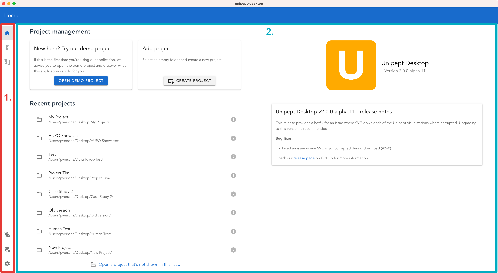
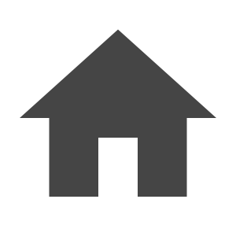
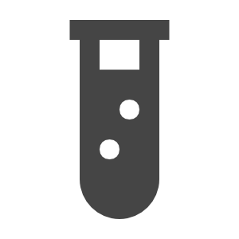
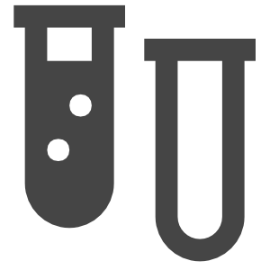
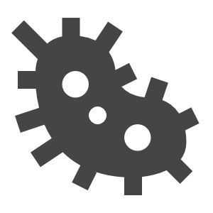
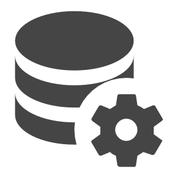
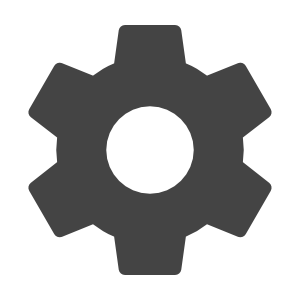

::: warning The Unipept Desktop application is deprecated
The app still works, but will no longer receive updates or new features.
All functionality previously unique to the desktop app has been migrated to the
[Unipept web application](https://unipept.ugent.be), which we recommend using going forward.
:::

## Application window {#application_window}

The application window will always consists of two main parts. On the far left (depicted in red in the
screenshot), you will find the sidebar. The sidebar is always visible and can be used to navigate
between the different windows of this application (each corresponding to a specific feature or
functionality). On the right (depicted in purple in the screenshot) the main content view is located.
This is the part of the application that will change depending on the selected tab in the sidebar.

## Sidebar {#sidebar}

Below you will find a short overview of all buttons that are present in the sidebar and what the
associated functionality of these buttons is. Dedicated documentation pages are available for each of
the functions / components described below.

| Button | Page | Description |
| ------ | ---- | ----------- |
| {width=50} | Home | The homepage of the application is dedicated to project management. Everytime you want to switch between projects, create a new project, or open an existing one, you will have to go back to this page. |
| {width=50} | Single assay analysis | In order to analyse individual samples (and browse the analysis results), you will have to navigate to the "single assay analysis" page. This page allows you to manage the contents of your project, manage studies and assays and browse the results of the analyses that were performed earlier. |
| {width=50} | Inter-assay comparative analysis | Unipept Desktop allows you to compare features between distinct samples. By navigating to the "inter-assay comparative analysis" page, you can select multiple samples in the project explorer view on the left and a set of features that should be compared between these samples. After properly selecting and configuring all settings on this page, an interactive heatmap visualization will automatically be generated. |
| {width=50} | Tryptic peptide analysis | All analysis types that have been described above require a project to be loaded. They perform a specific analysis on a set of peptides and aggregate the results. In contrast, the "tryptic peptide analysis" page allows you to perform a specific analysis on a single peptide. This component type generates a report with all information that is known about a single tryptic peptide and produces a list of all proteins that match with this peptide, as well as a taxonomic and functional annotation. |
| {width=50} | Targeted database management | If you want to construct, delete or modify a targeted protein reference database (for use with the metaproteomics analysis pipeline), you need to navigate to the "targeted database management" page. This page will provide you with a list of all available databases, their current construction status and a handy wizard that will guide you through the database construction process. |
| {width=50} | Settings | The behaviour of the Unipept Desktop application can be finetuned in a lot of cases. All available configuration options can be configured on the "settings" page. Some examples of this are the location of the Unipept Desktop application data directory, configuration settings for communication between Unipept and the local Docker Daemon, etc. |
