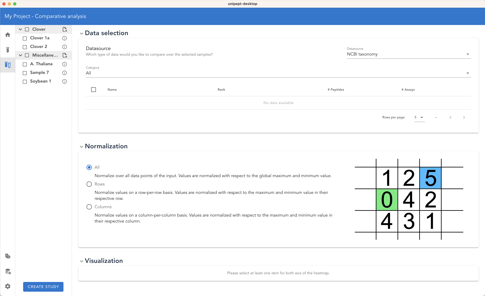
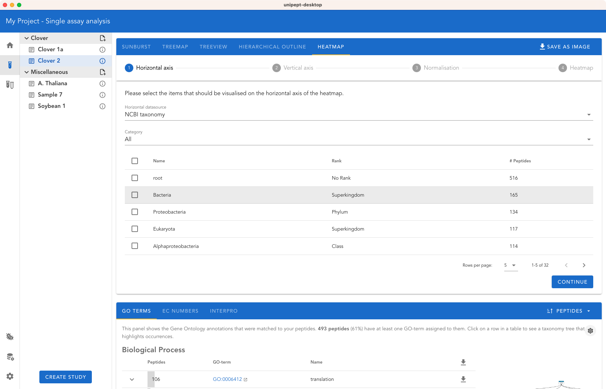
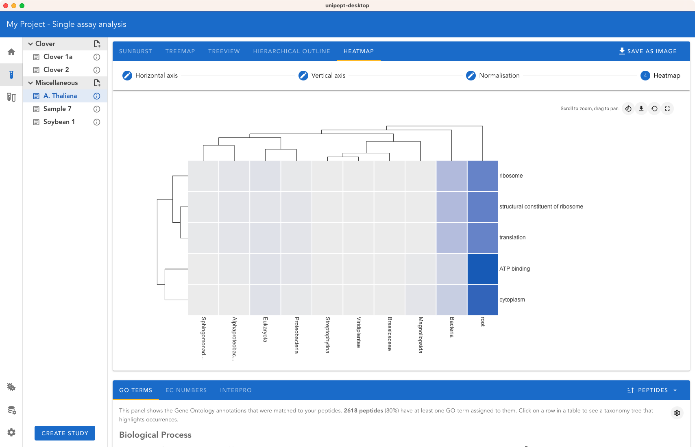
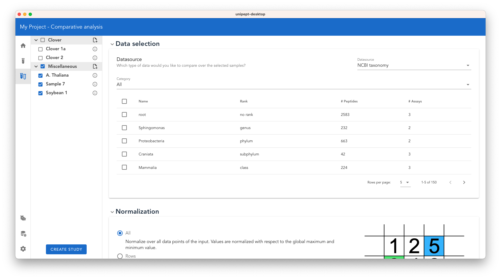
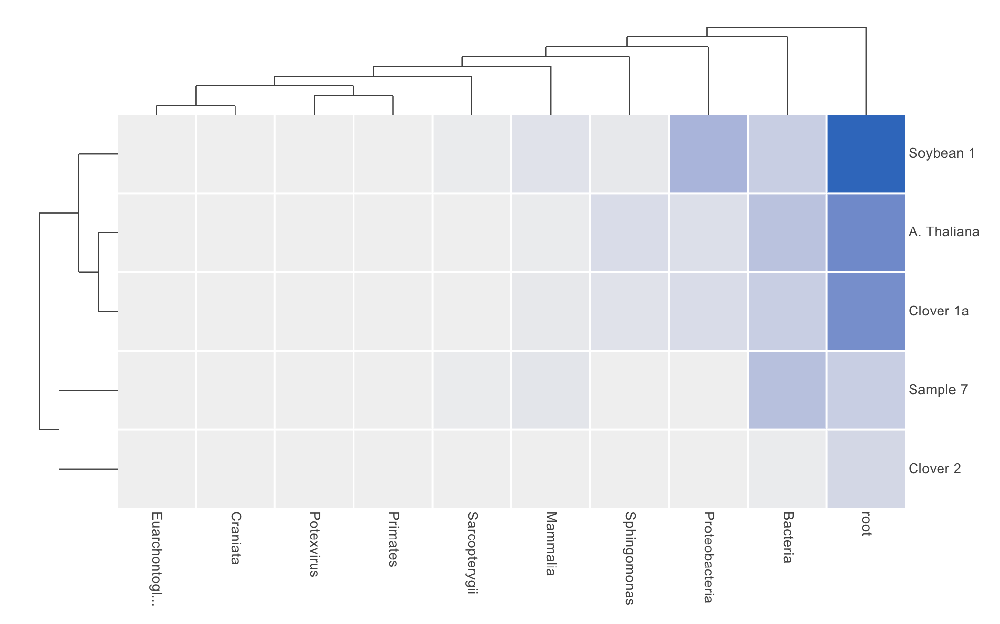

::: warning The Unipept Desktop application is deprecated
The app still works, but will no longer receive updates or new features.
All functionality previously unique to the desktop app has been migrated to the
[Unipept web application](https://unipept.ugent.be), which we recommend using going forward.
:::

## Overview {#overview}

Unipept offers a powerful tool for comparing features over multiple assays or within a single assay. This tool
can be used to gain insight into the shifts in population and function when studying multiple conditions or
changing environmental parameters. Unipept allows you to construct an interactive heatmap that is highly
configurable. On this page, we will guide you through the different steps that are required to construct such
a heatmap.

## Intra-assay comparison {#intra_assay_comparison}

The intra-assay comparison component of Unipept Desktop allows you to compare different features with each
other, within a single assay. This is useful when you want to compare the relative abundance of organisms or
functions in the assay. Follow the steps below to start constructing your own inter-assay comparative heatmap.

### Navigate to the heatmap wizard

First, make sure that you are situated on the "Single assay analysis" page. This page can be reached by
clicking the second button in the sidebar (indicated by a single test tube). On the middle of the page, you
will find all of the taxonomic analysis results of the assay. Click on the "heatmap" button, directly above
the visualizations, to navigate to the heatmap wizard.

### Select a data source for the horizontal axis

A heatmap always consists of two axes. For the single-assay comparison, you are free to chose what you want to
compare with each other and you are thus required to select a set of features for each axis individually. The
first step is to select a data source for the horizontal axis. This can be either a collection of features
from taxonomic or functional origin. First select a data source by clicking on the first dropdown (labeled by
"Horizontal data source"), then tick the checkbox in front of the features you want to include in the heatmap.

::: info Remark
Ticking the "select all" checkbox on the top left of the selection table will only select all features on the
current page. A button that allows you to select **all** features of this data source will appear once you
have selected at least one feature.
:::

After you're done selecting the features for the horizontal axis, click on the "next" button. The wizard will
now automatically navigate to the next step.

### Select a data source for the vertical axis

The second step in the wizard is identical to the first step and consists of picking features for the vertical
heatmap axis. Select a distinct set of features for the vertical axis in order to construct a useful heatmap
visualization.

### Pick a normalization type

The last step of the heatmap construction wizard consists of selecting the appropriate normalization type. You
can choose between the following options:

- **All:** compute the largest values over all cells in the heatmap and normalize all cells according to this
  one value.
- **Rows:** compute the largest value for each row in the heatmap and normalize all cells on a row-by-row
  basis. The relative values between distinct rows can not directly be compared in this case (but values
  within one row can).
- **Columns:** compute the largest vlaue for each column in the heatmap and normalize all cells on a
  column-by-column basis. The relative vales between distinct columns can not directly be compared in this
  case (but values within one column can).

After you're done, click the "next" button once again. The heatmap that you have constructed should appear
now.

## Inter-assay comparison {#inter_assay_comparison}

The inter-assay comparison component of Unipept Desktop allows you to compare different features over multiple
assays and investigate how the relative abundance of organisms or functions changes between different
conditions of an experiment. Follow the steps below to start construction your own intra-assay comparative
heatmap visualization.

### Assay selection

The first step in the process of constructing a heatmap consists of selecting a collection of assays for which
you want to compare features. You can select as many assays as you'd like, but note that computation time will
go up with the number of assays you select. You can select an assay by clicking the little checkbox in front
of the assay item in the project explorer, or you can select multiple assays at once by clicking the checkbox
in front of the study name (also in the project explorer, on the left side of the window).

### Data source selection

Once you have selected a collection of assays that you want to include in the comparison, you need to choose a
set of features that you want to compare between the different assays. A data source is one of the following:

- **NCBI Taxonomy:** choose from a list of all organisms that are identified in the selected assays.
- **Gene Ontology:** choose from a list of all Gene Ontology terms that are identified in the selected assays.
- **Enzyme Commission:** choose from a list of all Enzyme Commission numbers that are identified in the
  selected assays.
- **InterPro:** choose from a list of all InterPro-entries that are identified in the selected assays.

::: info Remark
Please note that you can only compare features from one datasource at a time. It's not possible to mix
features from distinct data sources and visualize them at the same time in the heatmap.
:::

### Normalization

The second step required for the heatmap construction consists of choosing which type of normalization should
be applied to the input data. There are three normalization types available:

- **All:** compute the largest values over all cells in the heatmap and normalize all cells according to this
  one value.
- **Rows:** compute the largest value for each row in the heatmap and normalize all cells on a row-by-row
  basis. The relative values between distinct rows can not directly be compared in this case (but values
  within one row can).
- **Columns:** compute the largest vlaue for each column in the heatmap and normalize all cells on a
  column-by-column basis. The relative vales between distinct columns can not directly be compared in this
  case (but values within one column can).

### Visualization

Once all of the previous steps have properly been configured, the end result will be shown here. If everything
goes well, you will be greeted by an interactive heatmap.

**Figure 2:** an example of a heatmap constructed using the inter-assay comparative pipeline of the Unipept Desktop application.
