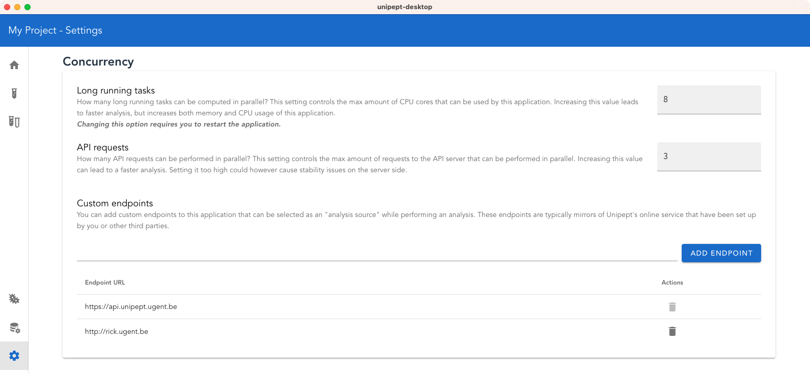
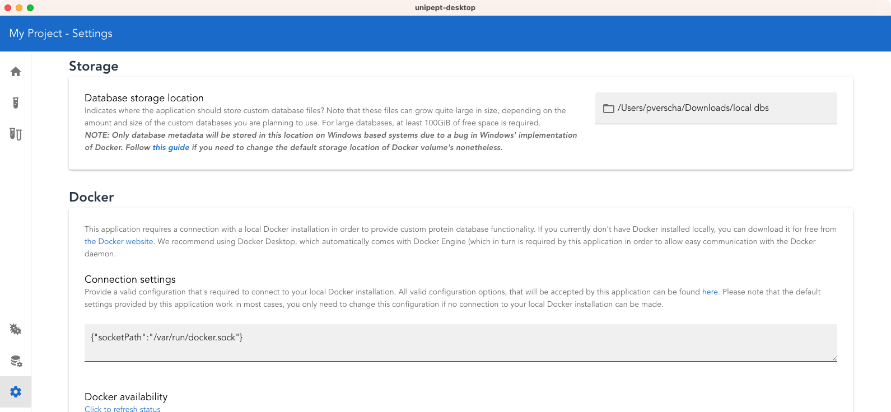
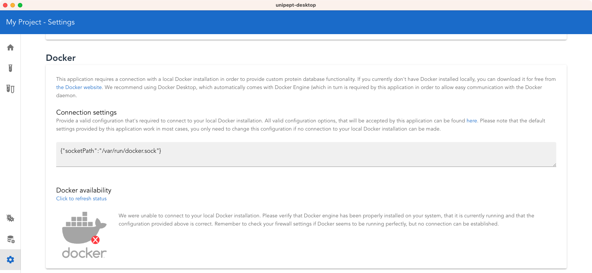

::: warning The Unipept Desktop application is deprecated
The app still works, but will no longer receive updates or new features.
All functionality previously unique to the desktop app has been migrated to the
[Unipept web application](https://unipept.ugent.be), which we recommend using going forward.
:::

## Concurrency {#concurrency}

The "Concurrency" section of the configuration options allows you to tweak a number of network settings that
are used by the Unipept Desktop application. These options typically influence the time it takes to perform a
single analysis, and the amount of network traffic that is generated at one point in time.

### Long running tasks

A long running task, in this context, is defined as a task that runs in the background and takes longer than a
few milliseconds to complete. A good example of such a long running task is reading in all of the peptides
found in an assay file. More than one of these tasks can be executed at the same time, and typically require
either a lot of processing power, or disk activity. In order to limit the impact of Unipept on the rest of
your system, you can limit the number of long running tasks that can be executed in parallel here. It is
recommended to set this value a little bit lower than the number of CPU cores that are available on your
system. This safeguards the reservation of some spare resources for other processes that might require
processing power.

### API requests

This option determines the amount of HTTP-requests that will be performed in parallel to our API-server.
Setting this to a higher value will typically improve analysis performance. However, setting it too high, can
cause a bigger load on our server (causing your requests to be delayed). It is recommended to set this to a
value between 1 and 5.

### Custom endpoints

If you are using our online service for the analysis of a sample, you are typically using the
[https://api.unipept.ugent.be](https://api.unipept.ugent.be) endpoint. Sometimes, however, you might be
interested to use a custom endpoint that's set up by a third party. This allows you, for example, to use a
local instance of the Unipept API-server and avoid sensitive data to be sent over the internet. Add custom
API-endpoints that adhere to the Unipept API-specification here. You can select which endpoint should be used
during the analysis of an assay.

## Storage {#storage}

### Database storage location

All targeted protein reference databases that are constructed by this application need to be stored in a
specific location. This setting can be used to change the location on the file system of where these custom
databases will be kept. Note that these files can grow very large in size and that it is recommended to keep
them on a fast (and preferably large) storage medium (such as an SSD).

## Docker {#docker}

Docker is a containerization platform that allows you to run applications in a sandboxed environment. This
sounds complicated, but means that you can run applications without having to install all of their
dependencies separately on your system and without having to worry about conflicts with other applications.
Docker is being used by the Unipept Desktop application for the construction of targeted protein reference
databases and for running a local instance of the Unipept API.

::: warning
Make sure that Docker Desktop is properly installed on your system. Otherwise, the settings for this
configuration options will not have any effect (and analyses using targeted protein reference databases will
not work properly). Check [this guide](https://docs.docker.com/get-docker/) for a quick explanation on how to
install Docker on your system.
:::

### Connection settings

Unipept Desktop needs to connect to the Docker daemon in order to manage containers and images. Normally, the
correct default connection settings for your system are used by default. If, however, the application is
unable to connect to the Docker daemon, then please verify that the settings here are correct and adjust where
necessary. You can check [this webpage](https://github.com/apocas/dockerode#getting-started) for more
information on what configuration values are excepted.

### Docker availability

By looking at the output presented here, you can verify that the application was able to succesfully connect to the Docker daemon. This output is mainly used for debugging purposes and allows you to verify the configuration of your Docker installation and what compute resources it has access to.
