::: warning The Unipept Desktop application is deprecated
The app still works, but will no longer receive updates or new features.
All functionality previously unique to the desktop app has been migrated to the
[Unipept web application](https://unipept.ugent.be), which we recommend using going forward.
:::

## Overview {#overview}

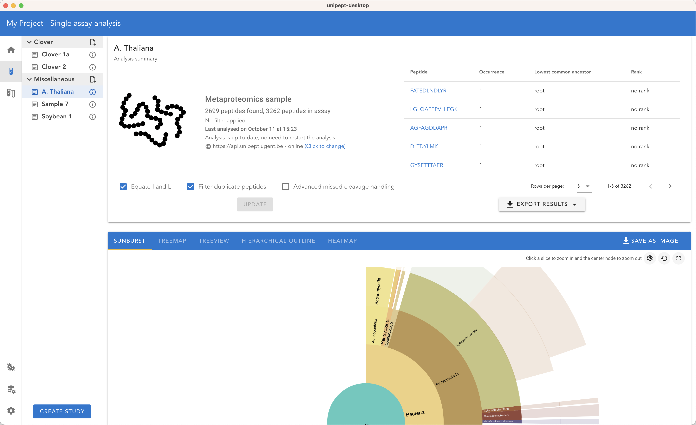

Unipept's web application provides users with the ability to analyze a metaproteomics sample and extract
taxonomic and functional information from environmental samples. Our web app provides interactive
visualizations to researchers and allows them to, for example, filter out all functions that are
associated with a specific taxon. Due to its inherent web-based nature, the size and amount of samples
that can be analysed are rather limited.

The Unipept Desktop application, however, is not limited in the amount of memory and storage that it can
consume, allowing us to process datasets with much more peptides than before. This a list of all major
differences between the Unipept desktop app and the web app:

- **Support for proteogenomics:** configure and construct your own
  targeted protein reference databases that only contain a subset of all the proteins from the
  UniProtKB resource.
- **Organise samples in studies and projects:** it's now easier than
  ever to combine and organise samples into studies and projects. One project contains all information
  required to reconstruct an experiment and can easily be shared with other researchers.
- **Analyse much larger samples:** since the desktop app is not
  artificially limited in the amount of compute resources that it is allowed to use, it allows you to
  analyse samples that contain much more peptides (when compared to the web app).
- **Improved inter- and intra-assay comparison pipeline:** the
  desktop app provides an improved comparative analysis pipline that allows you to compare both
  features within and between samples. This can help you to improve your insight in the functional
  or taxonomic shift that might occur in an ecosystem over time.

If you use our Unipept Desktop application, then please cite Verschaffelt et al. (2021) Journal of
Proteome Research:
[doi:10.1093/bioinformatics/btw039](https://academic.oup.com/bioinformatics/article/32/11/1746/1742840?login=false)

## Download {#download}

In order to use the Unipept Desktop Application, it needs to be installed first. You can always download
the most recent version for your operating system from the releases on GitHub. Direct links for the
different operating systems are also available (these links will always point to the most recent
version):

- [Download for Windows](https://github.com/unipept/unipept-desktop/releases/latest/download/Unipept-Desktop-x64.exe)
- Download for macOS:
  [Mac with Intel Processor (x86, AMD64)](https://github.com/unipept/unipept-desktop/releases/latest/download/Unipept-Desktop-x64.dmg)
  or [Mac with Apple Silicon Processor (ARM)](https://github.com/unipept/unipept-desktop/releases/latest/download/Unipept-Desktop-arm64.dmg)
- [Download for Linux](https://github.com/unipept/unipept-desktop/releases/latest/download/Unipept-Desktop-x86_64.AppImage)

Most required dependencies will automatically be installed using the installation packages provided
above. If a specific installer is not suitable for your current operating system (e.g. specific flavours
of Linux that do not support AppImage's), you can always clone the repository and build the project
yourselves.

::: warning
If your are planning to use the Unipept Desktop application to build custom targeted protein reference
databases (which are required for proteogenomics data analyses), then you also need to make sure that
[Docker Desktop](https://www.docker.com/products/docker-desktop/) is installed and working on
your system. See [this page](./configuration.md#docker) for more
information on how to set up Docker Desktop with the Unipept Desktop application.
:::

## Install for Windows {#windows_installation}

1. **Start the installer package**

   Double-click the installer package to start the installation. You will be greeted by a
   window that asks for your explicit approval to install our application. Click "More info".

   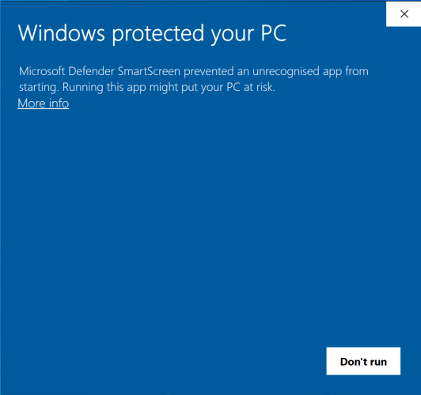

2. **Proceed with security checks**

   A new button appears "Run anyway". Click this button to start the installation process.
   Windows shows this warning as part of the "SmartScreen Security" system. This system
   protects your computer from running potentially unsafe apps. Windows displays this message
   for our application since it's very new, without a large userbase yet. The more people start
   to use this app, the faster it will be trusted by Microsoft.

   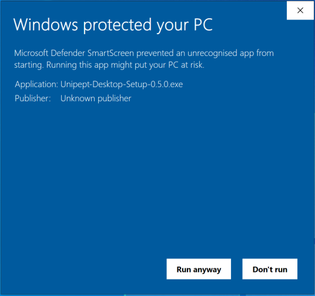

3. **Installation process is started**

   The installation process is now started, and a progress bar should be visible. This process
   should not take longer than one minute on most modern systems. Please wait for the installer
   to disappear (without any errors). Once it's gone, the installation process is fully
   finished.

   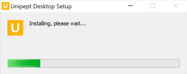

4. **Installation process is done**

   You can now start the application, by double clicking it's shortcut on your desktop or by
   selecting it from the applications list in Windows.

   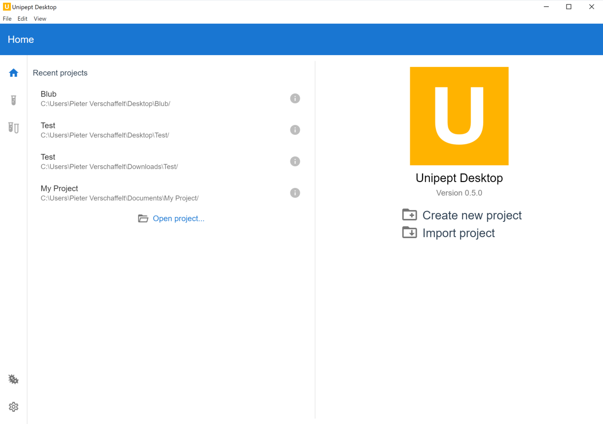

## Install for macOS {#macos_installation}

1. **Mount the installer image**

   Double-click the downloaded "Unipept.dmg" file to mount the installer image. A new window
   pops up in which you need to drag the Unipept Desktop logo into your applications folder.

   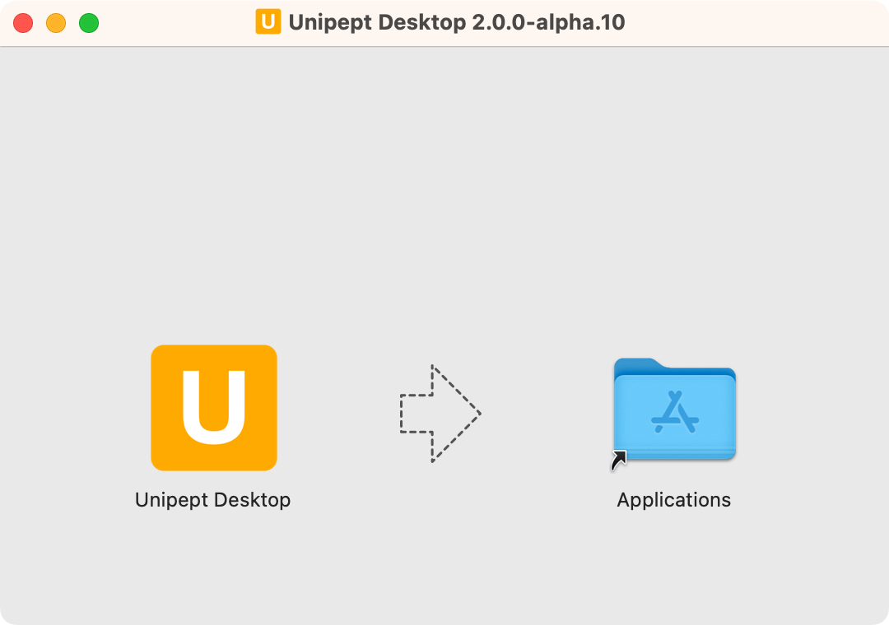

2. **Installation process is done**

   Look for the installed application in Launchpad and start Unipept Desktop.

   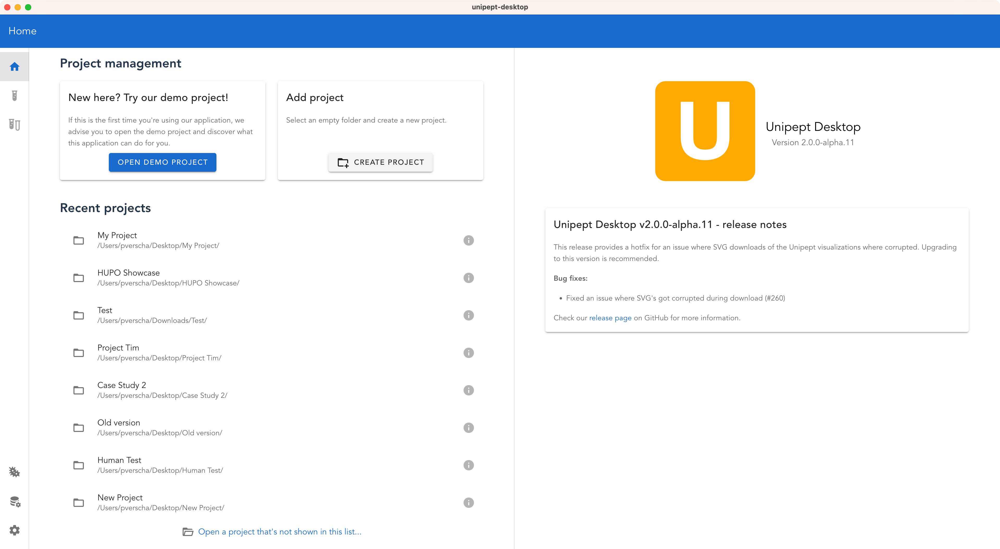

## Install for Linux {#linux_installation}

1. **Open AppImage properties**

   Right-click the downloaded "Unipept.AppImage" file and select "properties". A properties
   window will pop up.

   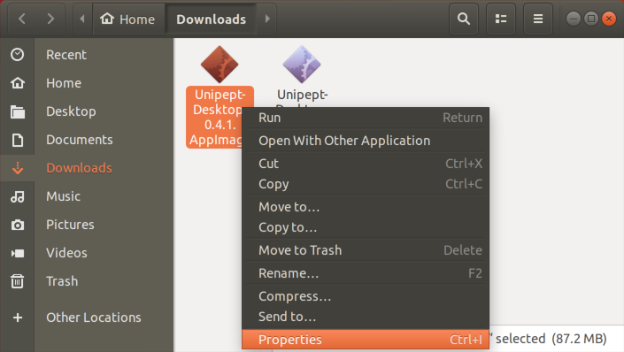

2. **Enable executable permissions**

   Click the "permissions" tab and check the box before "Allow executing file as program".
   Close the window.

   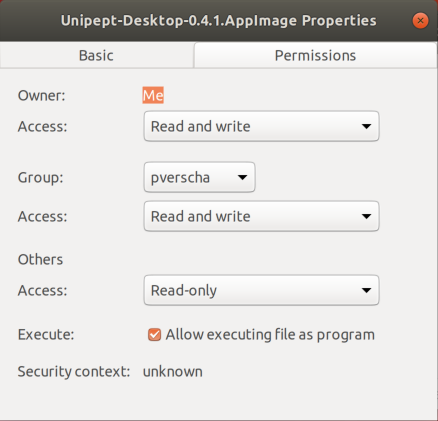

3. **Open the application**

   Double-click the downloaded AppImage-file to start the application.

   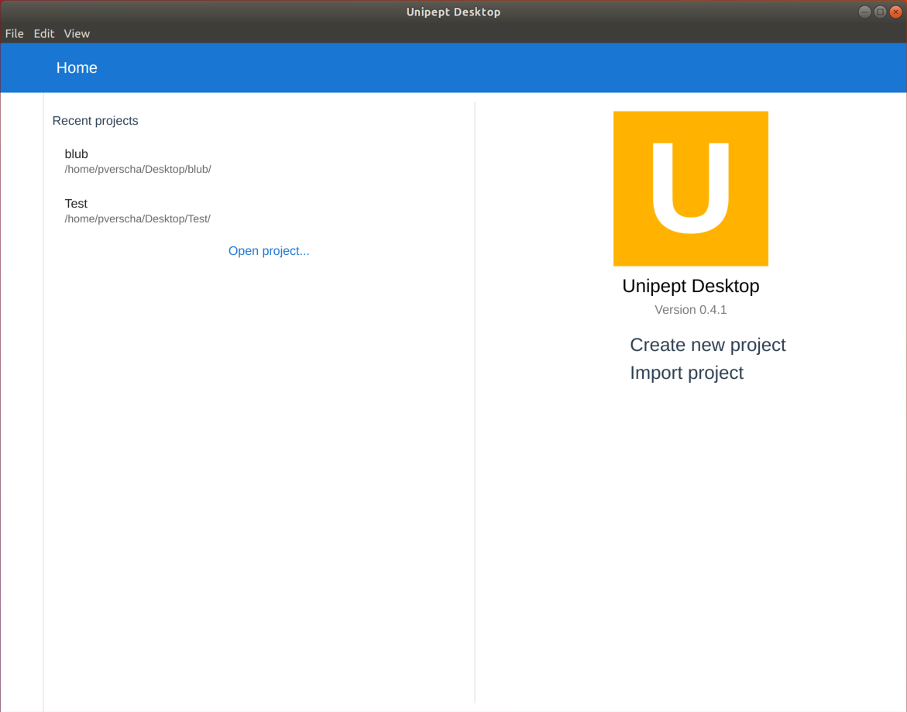

## First time use {#first_time_use}

If this is your first time using the application, we recommend to follow the steps in this guide to
get you started easily and to get acquainted with the basic functionality of the application.

### Static database download

A few things are automatically set up the first time you start this application. You will directly
notice a dialog popping up that downloads a small SQLite-database. This database is called the
"static database" and contains static information about taxa and functional annotations. Every
month, a new release of this database is automatically generated. Unipept Desktop will regularly check
for a new version of this database and automatically download it when necessary.

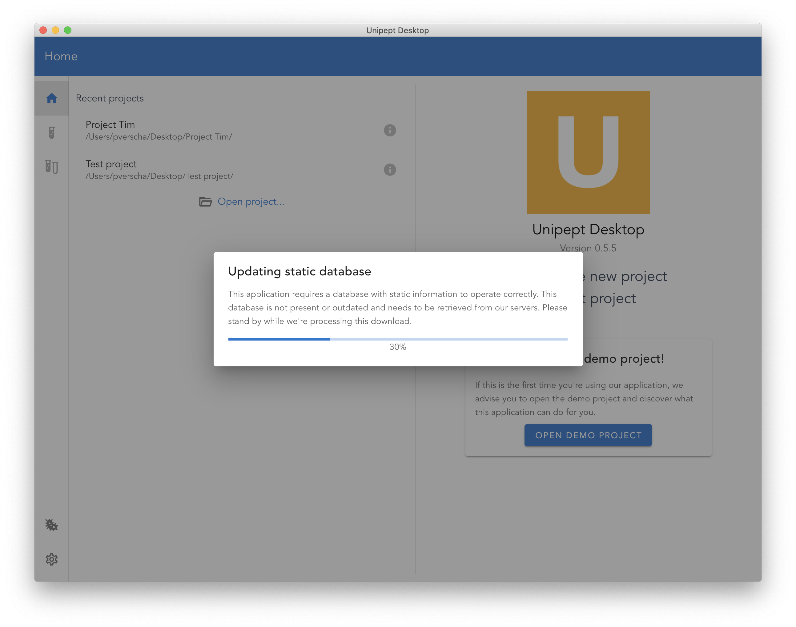

Download and installation of this static database can take a few minutes, depending on the available
speed of your internet connection. If, for some reason, the download fails, the application will
automatically fallback to a (slower) online version of this database and will continue to work. A new
attempt to install the database will be made when you restart the application.

### Opening the demo project

::: warning
Changes made to the demo project will not be saved! The demo project is read-only and all changes will
be lost when you close the application.
:::

Every assay or sample needs to be associated with a project. So, before you can start analyzing your
data, you need to create a project. However, since this is the first time you use the application, we
recommend you to click the "Open demo project" button. By doing so, a preconfigured project
will be loaded and you can quickly browse the analysis results that are being produced by Unipept
and play with some of its features.

### Creating a new project

In order to create a project of your own, head back to the homepage of the application by clicking on
the "home" button in the sidebar. Here, you will find a button to create a new project or to
reopen an existing project. Click the "New project" button, select an empty folder (or create
a new one) and continue.

### Saving a project

Changes made to projects are automatically saved. If you close the application, the current state of
the project will already be persisted and there's nothing else that needs to be done.

## Updating the application {#update}

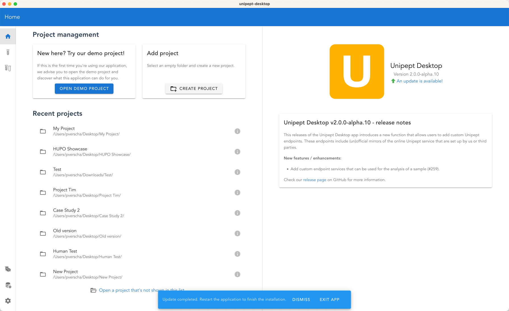

**Figure 1:** a notification is shown during the automatic
application update process on the bottom of the main application window.

The application will automatically be kept up-to-date. Everytime it is started, Unipept will
automatically contact the update-servers and check if a new version if available. If this is
the case, a notification will appear on the bottom of the application window. The notification shows
the update progress and will ask you to restart the application once the update is finished. The
previous version will be used as long as the app is not (manually) restarted.

A summary of all changes that were made between the current version of the application and the previous
version will always be displayed on the right side of the home page. This summary (for all versions)
is also available on our [release notes page](https://github.com/unipept/unipept-desktop/releases).

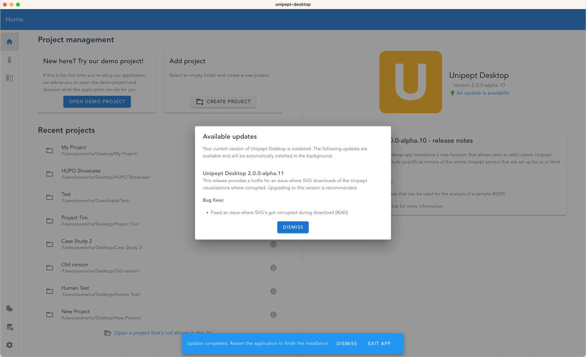

**Figure 2:** when an update is available, a small message will
appear on the homepage. A dialog with a summary of all changes will pop up after clicking on this
message.
