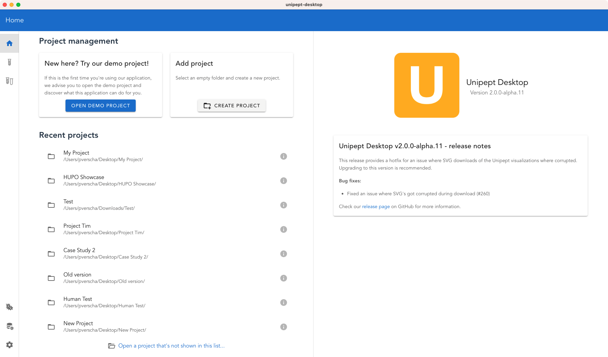

::: warning The Unipept Desktop application is deprecated
The app still works, but will no longer receive updates or new features.
All functionality previously unique to the desktop app has been migrated to the
[Unipept web application](https://unipept.ugent.be), which we recommend using going forward.
:::

## Overview {#overview}

Central to the working of Unipept Desktop is the concept of a project. A project is simply a collection of
studies and assays and is physically represented on your hard disk as a folder containing a set of files and
folders. All inputs and analysis results that belong to the project will be stored in this folder which means
that analyses performed earlier can easily be reloaded and reused. Since all required information is stored in
the project folder, these projects can also be shared with other researchers around the globe by simply
sending them a copy of the project's folder.

### Project structure

A project will always consists of a collection of studies that, in turn, contain a collection of assays. Each
of these terms is defined in a specific way:

- **Project:** A project is a collection of studies, and every study is a collection of assays. This
  terminology adheres to the definitions found in the [ISA-tab
  standard](https://isa-specs.readthedocs.io/en/latest/isatab.html).
- **Study:** A study is a collection of assays that are somehow related. They, for example, all originate from
  the same object under study. Every study needs to be uniquely named, no two studies with the same name in
  one project can exist! The application will inform you of a conflict, should one arise.
- **Assay:** An assay corresponds directly to a list of peptides and the configuration of search settings for
  this assay. Note that a project can thus contain multiple assays with the same peptide content, but with a
  different search configuration. Every assay should be uniquely named within a study. Assays with the same
  name can only occur within one project, if they belong to different studies.

### Physical representation

As described above, a single project will correspond to one root folder on your hard drive and will always
contain at least the following files and folders:

- **metadata.sqlite:** This file is a SQLite-database that keeps track of the analysis results and metadata
  that belongs to this project.
- **subfolder per study:** One folder per study is present. A study's name is derived from the folder's name.
  The study's name in the application will change if you change the name of this folder.
  - **file per assay:** The study folder also contains one file per assay that belongs to this study. These
    files end in the ".pep" extension and contain one peptide per line.

## Managing projects {#managing_projects}

The project management page is the central hub for managing projects. It allows you to create new projects,
open existing projects, and delete projects. The project management page is the first page that you will see
when you start the application and will also be shown whenever you click on the "home" button in the sidebar.

### The demo project

If this is the first time that you are using the application, it is recommended that you start by opening the
demo project and browse between the different features and pages of the app. The demo project contains some
studies and pre-loaded assays that showcase most capabilities of Unipept. In order to open the demo project,
click on the blue "Open demo project" button on the home page.

### Creating a project

To create a new project, click on the "Create new project" button on the home page. This will open a dialog
that allows you to select an empty folder on your hard drive where you want the project to live. If the folder
you selected already contains contents, the application will display an error.

### Opening a project

A list of the most recently created and opened projects is always shown on the home page. The simplest way of opening a project is to simply click on one of the items in this list. If, however, you decide to continue with a project that you have not opened for a while (or that has been downloaded from an external source), you should manually look for it on your hard drive. To do so, click on the blue text "Open a project that's not shown in this list" and select the wanted folder in the dialog that pops up.
