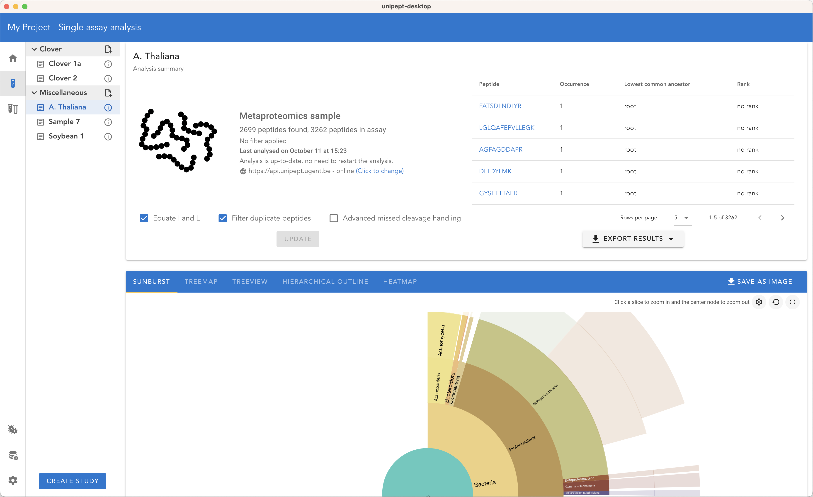
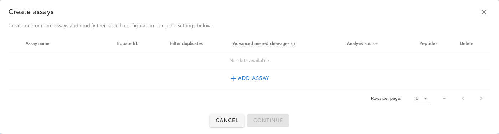
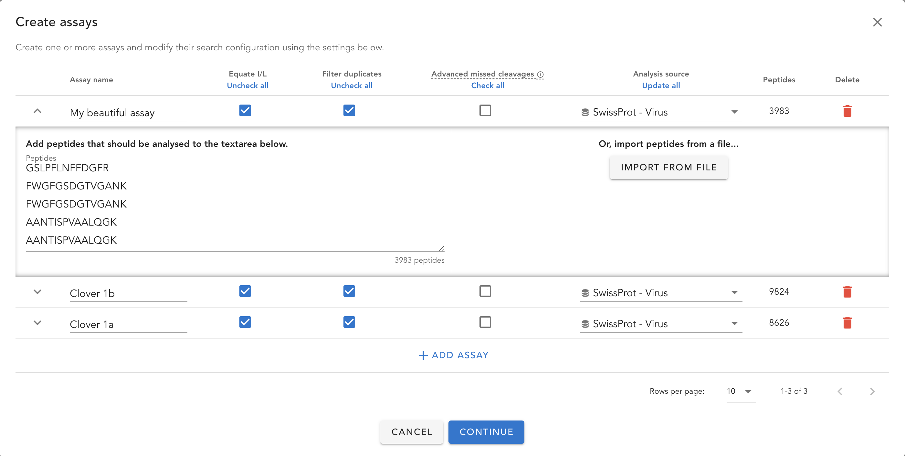
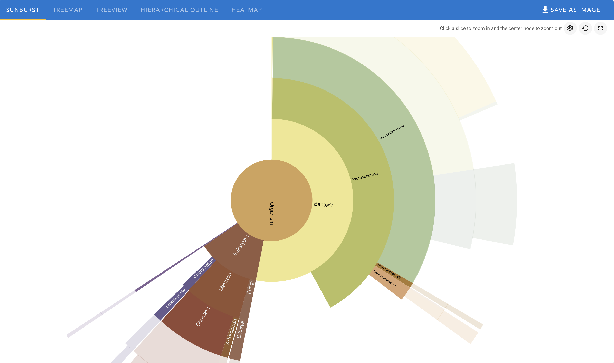
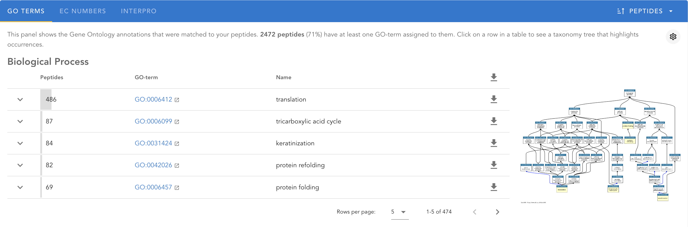
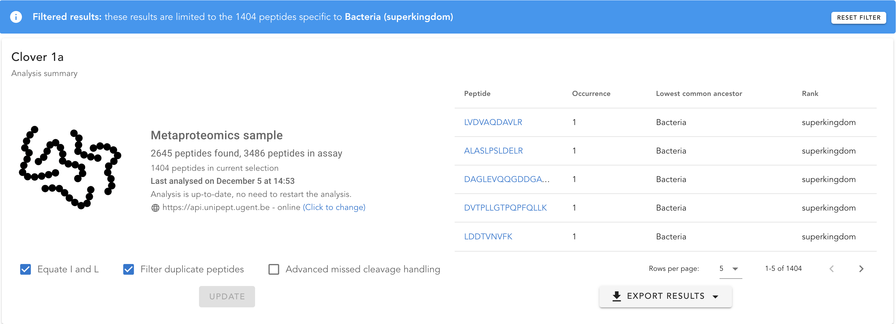

::: warning The Unipept Desktop application is deprecated
The app still works, but will no longer receive updates or new features.
All functionality previously unique to the desktop app has been migrated to the
[Unipept web application](https://unipept.ugent.be), which we recommend using going forward.
:::

## Overview {#overview}

The single assay analysis page provides you with the ability to analyse individual metaproteomics samples,
browse all samples in a project and organize them within a project (into studies). This page consists of three
main sections. The **sidebar** on the far left, the **project explorer** directly to the right of the sidebar
and the **content viewer**.

The sidebar allows is the same throughout all pages of the application and allows you to switch between the
different functions of the application. Directly to the right of the sidebar is the project explorer which
provides a view on the contents of the current project. It allows you to create studies or assays and to
switch between assays. The currently selected assay will be highlighted in blue and is the one for which the
taxonomic and functional composition can be viewed in the content viewer on the right.

## Analyse an assay {#analysing_assay}

### Start by creating a study

In order to add a new assay to the current project, you first have to make sure that at least one study
exists. An assay must be associated to a study at all times. If no study exists yet, you can create one by
clicking on the **Add study** button in the project explorer. You will notice that a new item appears in the
project explorer with the name "Study name". This is simply the default name that is given to newly create
studies and can easily be changed by either double-clicking the study or by right-clicking on the study item
and selecting **Rename study**.

::: info Remark
Please note that each study and assay must have a unique name. No two studies in one project (or two assays in
a study) can have the same name. This requirement will automatically be enforced by the application.
:::

### Adding one or more assays to a study

Once a study has been created, you can add a new assay by clicking the little file icon () on the right side of the study name. A dialog will pop up
(see Figure 1). This dialog allows you to create one (or more!) assays at once. If you click the **Add assay**
button, you will be prompted to choose between two options. The first option (**Empty assay**) allows you to
manually add a single assay. You will be required to paste a list of peptides into the text area that pops up
and choose a suiting name for your new assay. The second option (**Bulk import from files**) can be used when
you have a large number of peptide files that need to be imported at once. In this case, a new assay entry
will be added for each input file and the name of the assays will be deducted from the provided file name.

**Figure 1:** the assay creation dialog will guide you through the process of adding one or more assays to
your project.

::: info Remark
Please note that the application only accepts text-based files containing one peptide per line. These files
should end with the ".txt;" or ".pep" extension. If this is not the case, an error message will be displayed.
:::

### Configuring the assays before importing

**Figure 2:** search settings for each of the new assays can also be configured in the assay creation dialog.

It is important to note here that each assay can have its own search settings. These settings determine a set
of parameters that influence the outcome of your metaproteomics analysis:

- **Equate I/L:** Since the amino acids isoleucine and leucine share the same mass, they can be
  indistinguishable in a mass spectrometry experiment. By enabling this setting, Unipept will treat isoleucine
  and leucine as the same amino acid.
- **Filter duplicates:** By enabling this setting, only unique peptides will be retained. This means that if a
  peptide is found multiple times in the input file, only one occurrence will be retained.
- **Advanced missed cleavage handling:** If not all input peptides are tryptic peptides, you can enable this
  setting to allow for more peptides to be matched by Unipept. Enabling this setting will cause the analysis
  time to increase, so it is recommended only to use it when strictly necessary.
- **Analysis source:** The analysis source determines which protein reference database is used for the
  analysis of the corresponding sample. You can choose between Unipept's online services (which typically try
  to match the peptides against all proteins in UniProtKB) or a local database (that typically contains only a
  subset of the proteins in UniProtKB). Note that local databases can be constructed on the "Targeted database
  management" page.

Finally, click on **Continue** to import the assays into the current project and start the metaproteomic
analysis.

## Browse analysis results {#taxonomic_analysis_results}

Once an analysis is finished, the main results are split into a taxonomic and a functional part. On top of the
"Single assay analysis" page, you will directly see a summary of the analysis including some useful
statistics. Directly underneath this summary is a card that shows all taxonomic analysis results and on the
bottom is a third card that shows all functional analysis results.

### Taxonomic profile

In order to explore the taxonomic composition of a sample, users can browser through 4 different
visualizations that each try to model the same information in a different way. This allows individual users to
gain a deeper understanding of the organisms that are present in the sample. The tabs on top of the taxonomic
profile card allow you to switch between the different visualizations.

**Figure 3:** the taxonomic analysis of a metaproteomics sample results in a set of interactive visualizations
that can be used to explore the results.

### Functional profile

The functional profile of a sample can be explored in the last card on this page. A functional summary is
provided for all identified Gene Ontology terms, Enzyme Commission numbers and InterPro domains. You can
switch between these distinct types of functional annotations by using the tabs on top of the functional card.

**Figure 4:** the functional analysis of a metaproteomics sample results in a set of tables that allows users
to explore the different functional domains.

### Filtering by taxon

One of the key features of Unipept that distinguish it from other major metaproteomics analysis tools is it's
ability to keep track of the link between taxa and functions in a sample. This allows Unipept to filter all
functional annotations by a specific taxon which allows you to find out which functions are performed by which
set of organisms in the environment under study. In order to perform such a filtering, you can click on any of
the taxa in the taxonomic visualizations. If you, for example, click the "Bacteria" node in the sunburst, the
functional profile below will only take into account bacterial taxa.

**Figure 5:** if a taxonomic filter is active, a banner on top of the page will be clearly displayed (and also allows you to reset the filter).
