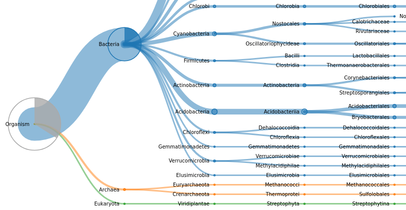

## Introduction

The Unipept Metagenomics Analysis Pipeline (UMGAP) is a tool for mapping (short) metagenomics reads to taxa, rivalling
state of the art alternatives such as Kraken (2014) with the additional benefit of species level identification. UMGAP
achieves this by transforming the mapping task into a metaproteomics problem by using various alternative gene
predictors on the metagenomics reads and processing the resulting data with the existing Unipept Metaproteomics Analysis
Pipeline. Each step in UMGAP is highly configurable.

## Preprocessing

Throughout this overview of UMGAP, all steps will have examples to demonstrate the exact usage. For this, we have
sampled 100 paired-end DNA reads from a dataset generated by Lindgreen et al. (2016) for their metabenchmark.
As this dataset contains paired-end reads in FASTQ format, and UMGAP operates on FASTA data, we perform a first
preprocessing step to convert the FASTQ into FASTA files. You can download these files to get the same results:
[A1.fq](/A1.fq) and [A2.fq](/A2.fq).

```console
$ umgap fastq2fasta A1.fq A2.fq | tee preprocessed.fa
>read1/1
ATCGCGCACGCGGCCGATGCCCCAGAAGAGATTGACAGCGGTGGGGCGGGCGGCGGCGAGGTGGTCGCAGATCTCGGCGACCTCTGCGTTGAGGGTCGGG
>read1/2
AAGATGGCGACTGGATGATGATCGCGCGGCAGGCCACCATCTACGATCCCGCAGTGAAGCATTACTAACCATGATGCGCAACGACTCGCTGTCAGAGCTA
>read2/1
AGATTGCTGGTGCGGGTGCTCTGCCGGGCTTCTTCATCTCGGACCGCGCATCCGATGCGCACACGGCACAGTAGGTATGCGGTGAGAGCACCTCGCTTTT
>read2/2
CGCAATCTTGCGGCGCACCGCGATCAAATCGGGATAGTCCGGTGTGTAACGCGTGCTCAGGTCATCTGCCCGTACCCGCAATACATTCAACTGTGTTTTA
>read3/1
CCCTCAAGCCCGATCGAACTTTCCTACTGCCCGACCTCAGCGCGGAGCATTACCGAATCGTCGTCAACAATCTCCCCGATGGCTTCTATGTGAACTCCAT
>read3/2
CAAAATGGAGTGGGCGCTACTGCTCCGTGAGCAGGGTCAGTTGGAGGGATTGGGGCGTGCGCTCGGGGATGCTAATGGCGGTGCCCCTGGATTCCTGAGA
```

This command will interleave the given FASTQ files and output a FASTA stream, in which the paired-ends alternate each
other.

## Protein translation

To convert the metagenomics reads into a metaproteomics problem, we need to translate the DNA fragments into protein
fragments. While any gene prediction tool can be used, UMGAP was tested with FragGeneScan (2010) and FragGeneScan++, our
in-house improved version of FragGeneScanPlus (2015), a predictor using Hidden Markov Models. Alternatively, you can
also try all possible translations and use the built-in six-frame translation tool.

Using gene prediction limits our tool to the coding regions of the given DNA reads. This limit caps the sensitivity of
our predictions, as we can offer no prediction for a read from a non-coding region. On the other hand, coding regions
are more conserved and the mutations that do occur often do not change the resulting amino acid.

For more information about the available options for the gene predictors, the FragGeneScan and FragGeneScan++ commands,
we refer to the [FragGeneScan](http://omics.informatics.indiana.edu/FragGeneScan/) and
[FragGeneScan++](https://github.com/unipept/FragGeneScanPlusPlus) documentation. Here, it suffices to say that the
commands below will write the predicted genes in FASTA format to a file called `predicted-genes.faa`.

```console
$ FGS -s preprocessed.fa -o predicted-genes -w0 -t illumina_10 -p 16 > /dev/null
$ rm predicted-genes.fnn predicted-genes.out # we don't use these files
```

```console
$ FGSpp -s stdin -o stdout -w 0 -r train -t illumina_10 -p 16 -m 3000 < preprocessed.fa | tee predicted-genes.faa
```

With our alternative six-frame translation option, we choose to translate all (`-a`) frames using the standard
translation table.

```console
$ umgap translate -a < preprocessed.fa | tee predicted-genes.faa
>read1/1|1
IAHAADAPEEIDSGGAGGGEVVADLGDLCVEGR
>read1/1|2
SRTRPMPQKRLTAVGRAAARWSQISATSALRVG
>read1/1|3
RARGRCPRRD*QRWGGRRRGGRRSRRPLR*GS
>read1/1|1R
PDPQRRGRRDLRPPRRRPPHRCQSLLGHRPRAR
>read1/1|2R
PTLNAEVAEICDHLAAARPTAVNLFWGIGRVRD
>read1/1|3R
RPSTQRSPRSATTSPPPAPPLSISSGASAACA
>read1/2|1
KMATG**SRGRPPSTIPQ*SITNHDAQRLAVRA
>read1/2|2
RWRLDDDRAAGHHLRSRSEALLTMMRNDSLSEL
>read1/2|3
DGDWMMIARQATIYDPAVKHY*P*CATTRCQS
>read1/2|1R
*L*QRVVAHHG**CFTAGS*MVACRAIIIQSPS
>read1/2|2R
SSDSESLRIMVSNASLRDRRWWPAARSSSSRHL
>read1/2|3R
ALTASRCASWLVMLHCGIVDGGLPRDHHPVAI
>read2/1|1
RLLVRVLCRASSSRTAHPMRTRHSRYAVRAPRF
>read2/1|2
DCWCGCSAGLLHLGPRIRCAHGTVGMR*EHLAF
>read2/1|3
IAGAGALPGFFISDRASDAHTAQ*VCGESTSL
>read2/1|1R
KSEVLSPHTYCAVCASDARSEMKKPGRAPAPAI
>read2/1|2R
KARCSHRIPTVPCAHRMRGPR*RSPAEHPHQQS
>read2/1|3R
KRGALTAYLLCRVRIGCAVRDEEARQSTRTSN
>read2/2|1
RNLAAHRDQIGIVRCVTRAQVICPYPQYIQLCF
>read2/2|2
AILRRTAIKSG*SGV*RVLRSSARTRNTFNCVL
>read2/2|3
QSCGAPRSNRDSPVCNACSGHLPVPAIHSTVF
>read2/2|1R
*NTVECIAGTGR*PEHALHTGLSRFDRGAPQDC
>read2/2|2R
KTQLNVLRVRADDLSTRYTPDYPDLIAVRRKIA
>read2/2|3R
KHS*MYCGYGQMT*ARVTHRTIPI*SRCAARL
>read3/1|1
PSSPIELSYCPTSARSITESSSTISPMASM*TP
>read3/1|2
PQARSNFPTARPQRGALPNRRQQSPRWLLCELH
>read3/1|3
LKPDRTFLLPDLSAEHYRIVVNNLPDGFYVNS
>read3/1|1R
MEFT*KPSGRLLTTIR*CSALRSGSRKVRSGLR
>read3/1|2R
WSSHRSHRGDC*RRFGNAPR*GRAVGKFDRA*G
>read3/1|3R
GVHIEAIGEIVDDDSVMLRAEVGQ*ESSIGLE
>read3/2|1
QNGVGATAP*AGSVGGIGACARGC*WRCPWIPE
>read3/2|2
KMEWALLLREQGQLEGLGRALGDANGGAPGFLR
>read3/2|3
KWSGRYCSVSRVSWRDWGVRSGMLMAVPLDS*
>read3/2|1R
SQESRGTAISIPERTPQSLQLTLLTEQ*RPLHF
>read3/2|2R
LRNPGAPPLASPSARPNPSN*PCSRSSSAHSIL
>read3/2|3R
SGIQGHRH*HPRAHAPIPPTDPAHGAVAPTPF
```

## Peptide profiling

UMGAP uses exact substring matching to identify reads. The next step of the pipeline fragments each amino acid sequence
into 9-mers. The k-mers of a string are all possible substrings of length k. For example, the 4-mers of the string
ABCDEFG are ABCD, BCDE, CDEF and DEFG. After constructing all possible 9-mers, they are matched against our index. This
index maps each 9-mer encountered in the UniProt's protein knowledgebase (2014) to the lowest common ancestor (LCA) of
all the organisms it occured in. The LCA of a set of taxa is equal to the taxon of the most specific rank in the NCBI
taxonomy (2011) that is either a descendant or an ancestor of all taxa in that set.

```console
$ umgap prot2kmer2lca -o -k9 9-mer.index < predicted-genes.faa | tee found-kmers.fa
>read1/1|1
0 0 0 0 0 0 0 0 0 0 35725 2759 1 1 1 2 515393 201174 0 1 0 0 0 379 0
>read1/1|2
0 0 0 0 0 0 0 0 0 1185650 1185650 140110 0 0 0 0 0 0 0 0 0 36842 0 1 162425
>read1/1|3
0 0 0 0 0 0 0 0 0 0 0 1773 47855 4530 1 1 1 1 1 0 35708 0 0 0
>read1/1|1R
0 0 0 0 2235 0 0 0 0 40674 1 1 2759 0 0 0 0 0 0 0 0 0 0 0 88724
>read1/1|2R
1 940557 1 940615 940615 940615 940615 940615 0 0 0 0 56 2 1 1 1 1 2 2 940615 940615 940615 940615 940615
>read1/1|3R
0 0 0 0 1036719 2 2759 0 2 1 1 1 2759 1 1 3916 3916 1760 0 237 1 2759 1 0
>read1/2|1
0 0 0 0 0 0 0 5627 0 0 0 0 0 0 0 0 0 0 0 0 0 0 0 0 1
>read1/2|2
0 52226 53355 1760 0 0 0 0 0 0 0 0 0 0 0 0 0 0 0 0 0 0 0 0 44471
>read1/2|3
940615 940615 940615 940615 940615 204434 204434 204434 204434 2 204434 204434 204434 0 0 0 0 0 0 0 0 0 0 0
>read1/2|1R
0 0 0 0 0 0 0 0 0 0 0 0 0 0 0 0 0 0 0 0 0 0 0 0 0
>read1/2|2R
1 0 0 0 0 0 0 0 0 0 0 0 0 0 0 0 0 0 0 0 0 0 1 4751 35708
>read1/2|3R
0 0 0 0 0 0 0 0 0 0 0 0 0 0 0 0 0 0 0 0 0 0 0 0
>read2/1|1
0 1813 546364 0 0 0 0 0 0 0 0 0 0 0 0 0 0 0 0 0 0 0 0 0 0
>read2/1|2
0 68786 0 0 0 0 0 0 0 0 0 0 0 0 0 0 0 0 0 0 0 0 0 0 0
>read2/1|3
2 392734 392734 392734 392734 0 0 0 0 0 0 0 0 0 392734 0 0 0 0 0 0 0 0 0
>read2/1|1R
0 0 0 0 0 0 0 0 36740 0 0 0 0 0 0 0 0 0 0 0 0 0 379 379 0
>read2/1|2R
0 0 0 0 0 0 0 0 0 0 0 0 0 0 0 0 0 0 0 0 0 0 0 0 0
>read2/1|3R
0 0 0 0 393310 0 0 0 0 0 0 0 0 0 0 0 0 0 0 0 0 0 0 0
>read2/2|1
0 0 0 0 0 0 0 0 0 0 0 0 0 0 0 0 0 0 0 0 0 0 0 0 0
>read2/2|2
1534 0 0 0 0 0 0 0 0 0 0 0 0 0 0 0 0 0 0 0 0 0 0 0 0
>read2/2|3
0 0 0 0 0 0 0 0 0 0 0 0 1370023 0 0 0 0 0 0 0 0 0 0 0
>read2/2|1R
0 0 0 0 0 0 0 0 0 0 0 0 0 0 0 0 0 488447 0 0 0 0 0 0 0
>read2/2|2R
0 0 0 0 0 0 33882 4930 4930 0 392734 1 392734 392734 392734 392734 392734 392734 392734 392734 392733 392733 392733 392733 392734
>read2/2|3R
0 0 0 0 0 0 0 0 0 0 0 0 0 0 0 0 0 0 0 0 0 0 0 0
>read3/1|1
0 0 0 0 0 0 0 0 0 0 1 0 0 0 0 1754192 0 6282 0 7164 0 0 0 0 0
>read3/1|2
0 0 0 0 0 0 0 0 0 0 0 0 0 0 0 0 0 0 0 0 0 0 0 0 0
>read3/1|3
332163 332163 332163 2 1 332163 2 332163 332163 332163 332163 332163 1 332163 332163 332163 332163 332163 332163 332163 332163 332163 0 0
>read3/1|1R
0 0 0 0 0 0 0 0 0 0 0 0 0 0 0 0 0 322865 7868 0 0 0 0 0 0
>read3/1|2R
0 0 0 0 0 0 0 0 0 0 0 0 0 0 0 0 0 0 0 0 0 0 0 0 0
>read3/1|3R
0 0 0 0 0 0 0 0 0 0 0 0 0 0 0 1 0 0 0 0 0 0 0 0
>read3/2|1
0 0 0 0 0 0 0 0 0 0 632569 0 0 0 0 0 0 0 0 0 0 0 0 0 0
>read3/2|2
0 0 0 8839 0 0 40754 0 0 0 0 323415 0 286 1 1760 0 0 0 0 0 0 0 0 0
>read3/2|3
0 0 0 0 0 0 0 0 0 0 0 0 0 0 0 0 28216 0 0 0 0 0 0 0
>read3/2|1R
332163 2 2 332163 332163 332163 332163 332163 332163 332163 1 332163 332163 332163 2 2 1 332163 332163 0 0 0 0 0 0
>read3/2|2R
67819 0 0 0 5855 1 1 2 519963 5206 0 1245748 0 0 0 0 0 0 0 0 0 101127 0 0 0
>read3/2|3R
0 0 0 0 0 0 0 0 0 0 0 0 0 0 0 0 0 0 0 0 13687 0 0 0
```

This command will look up each 9-mer in the input data and output the associated taxon if any is found. With the `-o` or
`--one-on-one` flag, the unrecognized 9-mers will be included as a "0" taxon, the use of which will be clarified in the
next step. Note: the real output would contain newlines between taxa, which have been replaced here by spaces for
readability.

## (Optional) Filtering

Especially when running the pipeline with all six frames, a lot of the translations are invalid since we expect only one
of the reading frames, rarely more, to yield a valid protein. The Seed-Extend step in the pipeline filters out most
random hits by selecting only 9-mer hits which are spatially close to other hits.

```console
$ umgap seedextend < found-kmers.fa | tee selected-seeds.fa
>read1/1|1
35725 2759 1 1 1 2 515393 201174
>read1/1|2
1185650 1185650 140110
>read1/1|3
1773 47855 4530 1 1 1 1 1
>read1/1|1R
40674 1 1 2759
>read1/1|2R
1 940557 1 940615 940615 940615 940615 940615 56 2 1 1 1 1 2 2 940615 940615 940615 940615 940615
>read1/1|3R
2 1 1 1 2759 1 1 3916 3916 1760
>read1/2|1

>read1/2|2

>read1/2|3
940615 940615 940615 940615 940615 204434 204434 204434 204434 2 204434 204434 204434
>read1/2|1R

>read1/2|2R

>read1/2|3R

>read2/1|1

>read2/1|2

>read2/1|3
2 392734 392734 392734 392734
>read2/1|1R
379 379
>read2/1|2R

>read2/1|3R

>read2/2|1

>read2/2|2

>read2/2|3

>read2/2|1R

>read2/2|2R
33882 4930 4930 392734 1 392734 392734 392734 392734 392734 392734 392734 392734 392733 392733 392733 392733 392734
>read2/2|3R

>read3/1|1

>read3/1|2

>read3/1|3
332163 332163 332163 2 1 332163 2 332163 332163 332163 332163 332163 1 332163 332163 332163 332163 332163 332163 332163 332163 332163
>read3/1|1R

>read3/1|2R

>read3/1|3R

>read3/2|1

>read3/2|2

>read3/2|3

>read3/2|1R
332163 2 2 332163 332163 332163 332163 332163 332163 332163 1 332163 332163 332163 2 2 1 332163 332163
>read3/2|2R
5855 1 1 2 519963 5206
>read3/2|3R
```

Note: the real output would contain newlines between taxa, which have been replaced here by spaces for readability.

```console
$ mv selected-seeds.fa found-kmers.fa # optional step, same format
```

The Seed-Extend algorithm requires spatial information which is provided by supplying the `-o` flag to the previous
command. The `taxons.tsv` is a file describing the NCBI taxonomic tree.

## Aggregation

At this step of the pipeline, we have a list of taxon identifiers per protein, one protein per reading frame, 6 reading
frames per paired-end and 2 paired-ends per metagenomics read. To get a single taxon identification per read, we need to
aggregate these 12 lists. UMGAP offers 3 alternative aggregation strategies with varying speciality.

- Unipept's lowest common ancestor strategy (LCA*), where the consensus taxon is, as before, the taxon of most specific
  rank which is either descendant or ancestor of every given taxon.

- Kraken's maximum root-to-leaf path (MRTL), where the consensus taxon is the taxon in the given list which has the most
  ancestors in the given list.

- A newly developed hybrid strategy, which combines LCA* and MRTL based on a given scaling factor (default 0.25). The
  hybrid method aims to ignore some outliers without compromising generality. This strategy is the default and will
  therefore be used below.

Before aggregating the results per read, we remove the markers from the headers with `sed` and combine the results of
each reading frame and paired-end with `uniq`.

```console
$ sed '/^>/s_/.*__' found-kmers.fa | umgap uniq | umgap taxa2agg taxons.tsv | tee classification.fa
>read1
940615
>read2
392734
>read3
332163
```

## Visualisation

Now that we have the results of our analysis, we'd like to visualise them. A frequency table and interactive
visualisations are available as the `taxa2freq` and `taxa2tree` commands. The first shows the number of reads mapping to
each taxon in CSV format, easily imported in other programs.

```console
$ umgap taxa2freq -r species taxons.tsv < classification.fa | tee report.csv
taxon id,taxon name,stdin
332163,Candidatus Solibacter usitatus,1
392734,Terriglobus roseus,1
940615,Granulicella tundricola,1
```

The `taxa2freq` command to snap each taxon to either a species or root (unknown) and report the frequency table of the
results.

The `taxa2tree` command will send the results to the Unipept webserver, where an interactive HTML-visualisation will be
created. The webpage can either be saved to a file, or you can request a shareable URL with --url.

```console
$ umgap taxa2tree --url < classification.fa
https://bl.ocks.org/5960ffd859fb17439d7975896f513bc3
```



## Recap

The complete UMGAP can be written as a single command. This allows the steps to run in parallel, further speeding up the
final result.

```console
$ umgap fastq2fasta A1.fq A2.fq |          # joining paired-end files
  umgap translate -a |                     # translating all six frames
  umgap prot2kmer2lca -o -k9 9-mer.index | # mapping each 9-mer onto a taxon or 0
  umgap seedextend |                       # filtering extended seeds
  sed '/^>/s_/.*__' |                      # dropping the paired-end and frame annotations
  umgap uniq |                             # joining equal headers (all taxa of the same read)
  umgap taxa2agg taxons.tsv |              # aggregating all taxa
  grep -v '^>' |                           # dropping headers
  umgap taxa2freq taxons.tsv               # make frequency table
taxon id,taxon name,stdin
332163,Candidatus Solibacter usitatus,1
392734,Terriglobus roseus,1
940615,Granulicella tundricola,1
```

This command processes the complete Metabenchmark A1 dataset containing 116 million paired-end reads in a VM (8 cores,
200GB RAM) on our computational server (16 Intel Xeon CPU E5-2650 v2 at 2.60GHz, 20*16GB RDIMM x4 Data Width at 1866MHz,
with the 9-mer index loaded in RAM) in 4h22, that is 1840 (paired-end) reads per second. Using FragGeneScan++ speeds
this up to 10100 reads per second.

### References

- Wood, D. E., & Salzberg, S. L. (2014). Kraken: ultrafast metagenomic sequence classification using exact alignments.
  Genome biology, 15(3), R46.
- Lindgreen, S., Adair, K. L., & Gardner, P. P. (2016). An evaluation of the accuracy and speed of metagenome analysis
  tools. Scientific reports, 6, 19233.
- Rho, M., Tang, H., & Ye, Y. (2010). FragGeneScan: predicting genes in short and error-prone reads. Nucleic acids
  research, 38(20), e191-e191.
- Kim, D., Hahn, A. S., Wu, S. J., Hanson, N. W., Konwar, K. M., & Hallam, S. J. (2015, August). FragGeneScan-Plus for
  scalable high-throughput short-read open reading frame prediction. Computational Intelligence in Bioinformatics and
  Computational Biology (CIBCB), 2015 IEEE Conference on (pp. 1-8), IEEE.
- UniProt Consortium. (2014). UniProt: a hub for protein information. Nucleic acids research, 43(D1), D204-D212.
- Federhen, S. (2011). The NCBI taxonomy database. Nucleic acids research, 40(D1), D136-D143.

