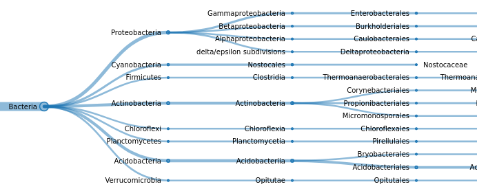

## Introduction

The Unipept Metagenomics Analysis Pipeline (UMGAP) is accompanied by 3 scripts: `umgap-setup.sh`, `umgap-analyse.sh` and
`umgap-visualize.sh`. The setup script deals with downloading prebuilt databases and checking and linking external
tools. The analyse script runs several analyses in sequence. The visualize script creates webpages from the results of
the analyse script.

The following pipelines are preconfigured:

- **UMGAP High Precision**: Optimized for high precision identifications on your metagenomics reads.
- **UMGAP Max Precision**: Optimized for highest precision, with a small setback on sensitivity.
- **UMGAP Tryptic Precision**: Made for fast analyses on your laptop. Fewer results, but accurate.
- **UMGAP High Sensitivity**: Optimized for high sensitivity identifications on metagenomics reads.
- **UMGAP Max Sensitivity**: Optimized for highest sensitivity, with a small setback on precision.
- **UMGAP Tryptic Sensitivity**: Made for fast analyses on your laptop. Get a quick overview of your data.

## Setup

The preconfigured pipelines require some databases and external tools. The setup script will help you to get these in
the right place. In general, you only need to run this script once, but you can also use it to verify the file locations
and download newer versions of the data. If you're planning to use the tryptic precision, tryptic sensitivity, high
precision or max precision pipelines, you'll need to install
[FragGeneScan++](https://github.com/unipept/FragGeneScanPlusPlus/) first. In this casestudy, we will use a tryptic
pipeline, so we don't have to download the 9-mer index (~12GiB, rather than ~150GiB).

Following code snippet shows the interaction with the setup script. It starts out by asking the relevant questions,
without delay. At the end, it downloads the relevant files in sequence, without further interaction.

```console
$ umgap-setup.sh -f /opt/FragGeneScanPlusPlus
Use '/home/user/.config/unipept' as configuration directory? [y]/n y
Created directory /home/user/.config/unipept.
Found, tested and remembered the FragGeneScan++ location.
Use '/home/user/.local/share/unipept' as data directory? [y]/n y
Created directory /home/user/.local/share/unipept.
Checking the latest version on the server.
Latest version is 2020-12-02.

For any type of analysis, you need a taxonomony. For mapping tryptic or
9-mer peptides to it, you need the respective index file of the same
version.

Would you like to download the taxonomy from 2020-12-02 (115MiB)? [y]/n y
Would you like to download the tryptic index from 2020-12-02 (12GiB)? [y]/n y
Would you like to download the 9-mer index from 2020-12-02 (152GiB)? [y]/n n
  % Total    % Received % Xferd  Average Speed   Time    Time     Time  Current
Dload  Upload   Total   Spent    Left  Speed
100  114M  100  114M    0     0  6477k      0  0:00:18  0:00:18 --:--:-- 6332k
  % Total    % Received % Xferd  Average Speed   Time    Time     Time  Current
Dload  Upload   Total   Spent    Left  Speed
100   12G  100   12G    0     0  5076k      0  0:34:12  0:34:12 --:--:-- 5790k
```

To change where the setup script will store the configuration and downloaded files, add some of the options detailed
below. If you're familiar with the setup script, or you're running the script within another script, you can add the
`-y` flag to run without interaction.

| Option | Description |
| ------ | ----------- |
| **-c dir** | Set a different configuration directory. |
| **-f dir** | Link the location of your FragGeneScan installation. |
| **-d dir** | Set a different location for downloading the database files. This can be on a separate disk. |
| **-y** | Download all files of the latest version without asking for confirmation. |

## Analysis

When setup is complete, the analyse script will automatically use the downloaded databases and linked tools. The input
data consists of a 100 paired-end reads sampled from a dataset generated by Lindgreen et al. (2016) for their
metabenchmark. With these paired-end reads in the [A1.fq](/A1.fq) and [A2.fq](/A2.fq) files, the commands are as
follows.

```console
$ head -4 A1.fq
@1198114###CP002480-_Acidobacteria_733918/1
ATCGCGCACGCGGCCGATGCCCCAGAAGAGATTGACAGCGGTGGGGCGGGCGGCGGCGAGGTGGTCGCAGATCTCGGCGACCTCTGCGTTGAGGGTCGGG
+
AADEGGAGIIEIHFHKHJKKJKHIJJIIKCJAHBFKKFHIJIF;JIH5DE$I>CBE$E:FGEJCGABEEECCDKD?D?C$ECEEE;CEEDEEAD=?ED$D
$ umgap-analyse.sh -1 A1.fq -2 A2.fq -t tryptic-precision -z -o tryptic-precision-output.fa.gz
$ zcat tryptic-precision-output.fa.gz | head -2
>1198114###CP002480-_Acidobacteria_733918/1_1_100_-
1
```

It seems the pipeline cannot be more specific than root (Taxon ID 1) for the first read.

If you used a non-default configuration directory for setup, you'll need to pass the same directory here, with the `-c`
option. When running the pipeline on large samples, it may be useful to compress the output. Use the `-z` flag to GZIP
the results. Should the input be GZIP-compressed, the script will detect this. Note that all arguments can be repeated
to bundle multiple analysis, each series ending with a `-o` option.

| Option | Description |
| ------ | ----------- |
| **-c dir** | Set a different configuration directory. |
| **-z** | Request compression of the output file. |
| **-1 file** | Single ended FASTA or first pair-ended FASTQ input file, optionally compressed. |
| **-2 file** | Second pair-ended FASTQ input file, optionally compressed. |
| **-t** | Type of the analysis (high precision by default). |
| **-o file** | The output file. |

## Visualize

After analysis, you probably want to view the results. While the analyse script output format is easily parsed, you can
also use the visualize script to create importable CSV frequency tables and interactive visualisations. The interactive
visualisations can be stored locally or hosted online. The following snippet creates all three in turn.

```console
$ umgap-visualize.sh -t -r phylum tryptic-precision-output.fa.gz
taxon id,taxon name,tryptic-precision-output.fa.gz
1117,Cyanobacteria,2
57723,Acidobacteria,4
201174,Actinobacteria,4
1224,Proteobacteria,5
1,root,160
$ umgap-visualize.sh -w tryptic-sensitivity-output.fa.gz > tryptic-sensitivity.html
$ umgap-visualize.sh -u tryptic-sensitivity-output.fa.gz
tryptic-sensitivity-output.fa.gz: 
https://bl.ocks.org/11b7809d6754b9530cf1a49d93a8d568
```

The CSV tables contain a record for each taxon found in the sample. A record contains, in order, the taxon ID, (for
convenience) the taxon name and the number of reads assigned to this taxon or below. All records will be at the same
specified taxon rank or at root (unidentified).

| Option | Description |
| ------ | ----------- |
| **-t** | Output a CSV frequency table on species rank. |
| **-w** | Output an HTML webpage of an interactive visualization. |
| **-u** | Print a shareable URL to a online interactive visualisation. |
| **-r rank** | Set the rank for the CSV frequency table (default: species). |



### References

- Lindgreen, S., Adair, K. L., & Gardner, P. P. (2016). An evaluation of the accuracy and speed of metagenome analysis
  tools. Scientific reports, 6, 19233.

