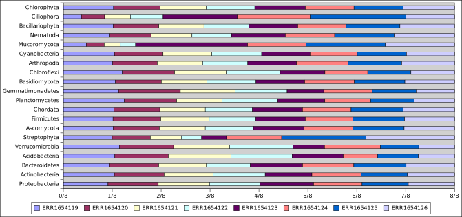

## Setup

This case study effectively repeats an analysis of 8 shotgun metagenomics samples and the comparison of the taxonomic
diversity therein (De Tender, 2019), with a more recent version of the UniprotKB and UMGAP.

The raw sequence data of the shotgun metagenomics sequencing is freely available at
[ENA](https://www.ebi.ac.uk/ena/browser/view/PRJEB15448) under the project ERP017180. We will start our casestudy by
downloading these files manually or via the command line.

```console
$ mkdir casestudy && cd casestudy
$ curl -O ftp.sra.ebi.ac.uk/vol1/fastq/ERR165/009/ERR1654119/ERR1654119_1.fastq.gz \
-O ftp.sra.ebi.ac.uk/vol1/fastq/ERR165/009/ERR1654119/ERR1654119_2.fastq.gz \
-O ftp.sra.ebi.ac.uk/vol1/fastq/ERR165/000/ERR1654120/ERR1654120_1.fastq.gz \
-O ftp.sra.ebi.ac.uk/vol1/fastq/ERR165/000/ERR1654120/ERR1654120_2.fastq.gz \
-O ftp.sra.ebi.ac.uk/vol1/fastq/ERR165/001/ERR1654121/ERR1654121_1.fastq.gz \
-O ftp.sra.ebi.ac.uk/vol1/fastq/ERR165/001/ERR1654121/ERR1654121_2.fastq.gz \
-O ftp.sra.ebi.ac.uk/vol1/fastq/ERR165/002/ERR1654122/ERR1654122_1.fastq.gz \
-O ftp.sra.ebi.ac.uk/vol1/fastq/ERR165/002/ERR1654122/ERR1654122_2.fastq.gz \
-O ftp.sra.ebi.ac.uk/vol1/fastq/ERR165/003/ERR1654123/ERR1654123_1.fastq.gz \
-O ftp.sra.ebi.ac.uk/vol1/fastq/ERR165/003/ERR1654123/ERR1654123_2.fastq.gz \
-O ftp.sra.ebi.ac.uk/vol1/fastq/ERR165/004/ERR1654124/ERR1654124_1.fastq.gz \
-O ftp.sra.ebi.ac.uk/vol1/fastq/ERR165/004/ERR1654124/ERR1654124_2.fastq.gz \
-O ftp.sra.ebi.ac.uk/vol1/fastq/ERR165/005/ERR1654125/ERR1654125_1.fastq.gz \
-O ftp.sra.ebi.ac.uk/vol1/fastq/ERR165/005/ERR1654125/ERR1654125_2.fastq.gz \
-O ftp.sra.ebi.ac.uk/vol1/fastq/ERR165/006/ERR1654126/ERR1654126_1.fastq.gz \
-O ftp.sra.ebi.ac.uk/vol1/fastq/ERR165/006/ERR1654126/ERR1654126_2.fastq.gz
```

While these files are downloading (combined size is 42GB), you can install and configure UMGAP. For this case study,
we'll need the NCBI taxonomy and the 9-mer index file (152GB), so answer "yes" when the setup script asks for those.

## Analysis

The next step and most time-consuming step is the analysis. We'll analyse all samples in a single run so we must only
load the database in memory once.

```console
$ umgap-analyse.sh \
-1 ERR1654119_1.fastq.gz -2 ERR1654119_2.fastq.gz -t high-sensitivity -z -o ERR1654119.tid.fa.gz \
-1 ERR1654120_1.fastq.gz -2 ERR1654120_2.fastq.gz -t high-sensitivity -z -o ERR1654120.tid.fa.gz \
-1 ERR1654121_1.fastq.gz -2 ERR1654121_2.fastq.gz -t high-sensitivity -z -o ERR1654121.tid.fa.gz \
-1 ERR1654122_1.fastq.gz -2 ERR1654122_2.fastq.gz -t high-sensitivity -z -o ERR1654122.tid.fa.gz \
-1 ERR1654123_1.fastq.gz -2 ERR1654123_2.fastq.gz -t high-sensitivity -z -o ERR1654123.tid.fa.gz \
-1 ERR1654124_1.fastq.gz -2 ERR1654124_2.fastq.gz -t high-sensitivity -z -o ERR1654124.tid.fa.gz \
-1 ERR1654125_1.fastq.gz -2 ERR1654125_2.fastq.gz -t high-sensitivity -z -o ERR1654125.tid.fa.gz \
-1 ERR1654126_1.fastq.gz -2 ERR1654126_2.fastq.gz -t high-sensitivity -z -o ERR1654126.tid.fa.gz
```

We can analyse the output files (`*.tid.fa.gz`) individually or comparatively. For the first, UMGAP includes a command
to create interactive visualisations. For each output file, we get a link.

```console
$ umgap-visualize.sh -u *.tid.fa.gz
ERR1654119.tid.fa.gz: 
https://bl.ocks.org/5055456c85e9e103da221fbba6e6c269
ERR1654120.tid.fa.gz: 
https://bl.ocks.org/31e0fc6e2d8705e5ef64e856318dc17c
ERR1654121.tid.fa.gz: 
https://bl.ocks.org/019b89c96446a2949423d34f4281ee1c
ERR1654122.tid.fa.gz: 
https://bl.ocks.org/3542a2a24fcf5ed3a791e937d2d6e618
ERR1654123.tid.fa.gz: 
https://bl.ocks.org/ccc88f795dbd797b08cfe7c8d1187a13
ERR1654124.tid.fa.gz: 
https://bl.ocks.org/794f9907fbb2488d94f94ccb7d06d835
ERR1654125.tid.fa.gz: 
https://bl.ocks.org/7568952f1338768a6b62d32928c0ee74
ERR1654126.tid.fa.gz: 
https://bl.ocks.org/f25941840ce1e706623750d561d7c47d
```

## Visualisation

The 8 analysed samples are, however, related. We would like to have comparative results. UMGAP does not support such
visualisations directly, but all results can be exported to a comparative CSV frequency table at a rank of choice, e.g.
genus or phylum, as below.

```console
$ umgap-visualize.sh -r phylum -t *.tid.fa.gz > frequencies.csv
$ head -10 frequencies.csv
taxon id,taxon name,ERR1654119.taxa.fasta.gz,ERR1654120.taxa.fasta.gz,ERR1654121.taxa.fasta.gz,ERR1654122.taxa.fasta.gz,ERR1654123.taxa.fasta.gz,ERR1654124.taxa.fasta.gz,ERR1654125.taxa.fasta.gz,ERR1654126.taxa.fasta.gz
1239,Firmicutes,83406,150700,80856,174901,80888,78400,95509,132121
2497438,Perkinsozoa,161,284,122,285,148,135,171,267
1752735,Candidatus Wolfebacteria,113,209,108,231,124,82,109,162
1817902,Candidatus Brennerbacteria,4,5,4,5,2,4,6,1
221216,Candidatus Parcubacteria,734,1485,823,1646,914,935,1304,1788
1817898,Candidatus Blackburnbacteria,28,66,26,57,18,41,49,68
3041,Chlorophyta,6439,11167,5921,13904,6303,6138,6897,10420
1913638,Zoopagomycota,1261,1730,937,2292,9727,6500,6728,7377
2732406,Kitrinoviricota,38,76,59,102,43,37,60,86
```

This CSV file can be processed by your favorite spreadsheet software or statistical analysis frameworks such as R
(packages of interest are [phyloseq](https://joey711.github.io/phyloseq/) and
[vegan](https://cran.rstudio.com/web/packages/vegan/index.html), and [ggplot2](https://ggplot2.tidyverse.org/) for
visualizations). For this study, it's interesting to have a look at the fraction each of the 20 most detected phyla
represents in its sample. For phyla uninfluenced by the addition of chitin to the sample, we expect to see a uniform
spread over all 8 samples. The Mucoromycota and Ciliophora phyla, however, are overrepresented in the 4 chitin-rich
samples.



### References

- De Tender, C., Mesuere, B., Van der Jeugt, F. et al. Peat substrate amended with chitin modulates the N-cycle,
  siderophore and chitinase responses in the lettuce rhizobiome. Sci Rep 9, 9890 (2019).
  [doi.org/10.1038/s41598-019-46106-x](https://doi.org/10.1038/s41598-019-46106-x)

